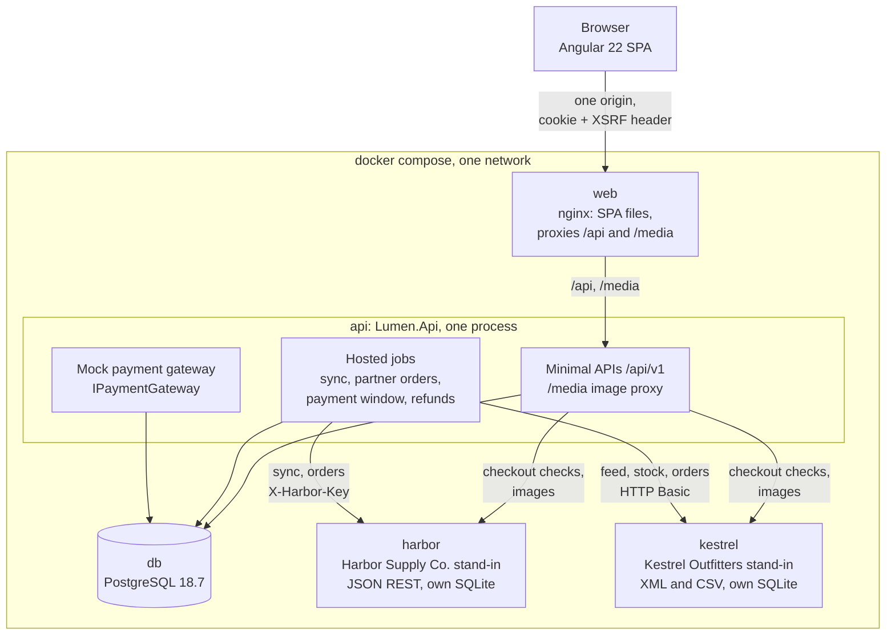
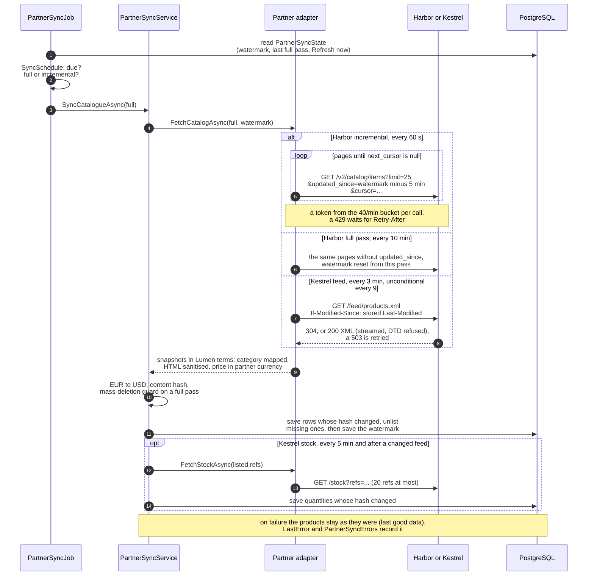
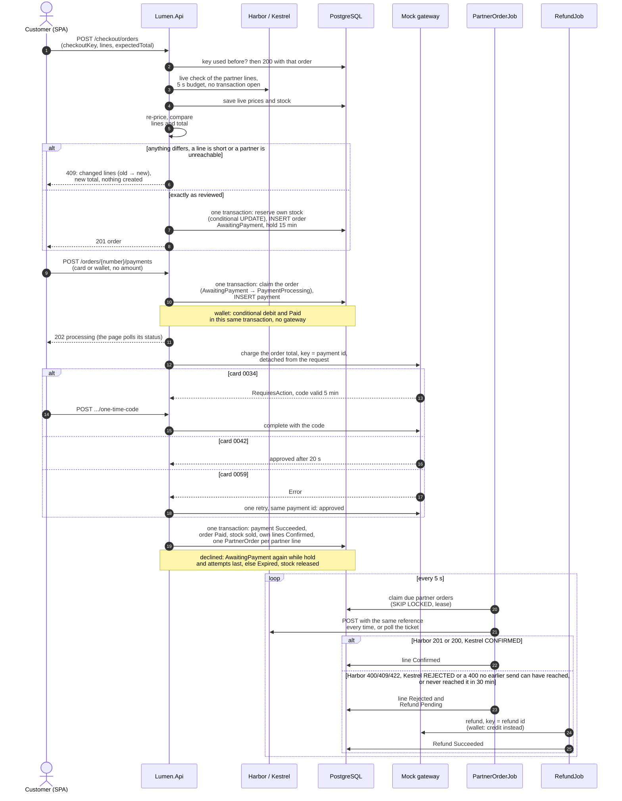
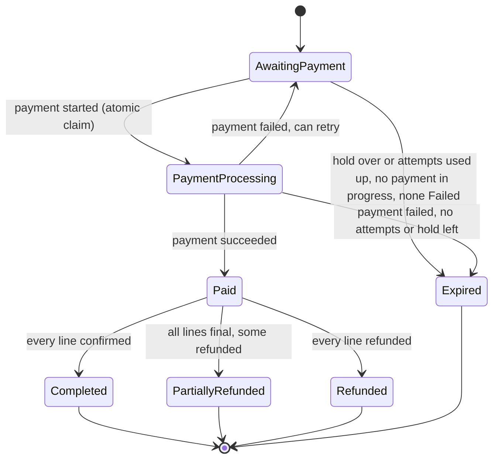

# Lumen Goods: design

How the solution is structured. The reasons for each decision are in the [ADRs](docs/adr/README.md), the rules and their tests in [BUSINESS-RULES.md][rules], and the choices made where the spec is silent in [ASSUMPTIONS.md][assumptions].

## 1. Goals and quality priorities

| # | Goal | How the design serves it |
|---|---|---|
| 1 | Correctness of money and stock | One rounding rule and one `PricingService`. The order is the price lock. Conditional `UPDATE`s backed by constraints ([0004][adr4], [0006][adr6]) |
| 2 | Partner contract fidelity | Stand-ins are separate processes with conformance tests. Lumen adapts only in its adapters. An architecture test forbids shared code ([0002][adr2]) |
| 3 | Resilience to partner outages | Pages read only Lumen's database. Partner calls have timeouts, retries and breakers. A failed sync keeps the last good data ([0003][adr3]) |
| 4 | Changeability | Feature folders on a pure domain project, one port per partner capability, validated configuration, rule IDs from code to test, §9 |
| 5 | One-command run | `docker compose up --build`: migrations and seed at start-up, health-checked start order, the same compose smoke test in CI |

## 2. Context and containers

| Service | Built from | Host port | State |
|---|---|---|---|
| `web` | `src/web/Dockerfile` (Angular build, nginx) | 8080 | none |
| `api` | `src/Lumen.Api/Dockerfile` | none | volume `api-keys` (Data Protection keys) |
| `db` | `postgres:18.7-alpine3.24` | none | volume `db-data` |
| `harbor` | `src/StandIns/HarborSupply.StandIn/Dockerfile` | 8081 | own SQLite |
| `kestrel` | `src/StandIns/KestrelOutfitters.StandIn/Dockerfile` | 8082 | own SQLite |
| `aspire-dashboard` (profile `observability` only) | `mcr.microsoft.com/dotnet/aspire-dashboard:13.6.5` | 18888 | in memory |

Ports bind to 127.0.0.1. Start order: `db` healthy, then `api` healthy (migrated and seeded), then `web`. The browser sees one origin (no CORS) and never calls a partner: the sandbox ports exist for inspection and the demo CLI ([Harbor][harbor-readme], [Kestrel][kestrel-readme]). `Partners:*:BaseUrl` can point at any implementation of the contracts.

## 3. Building blocks

`Lumen.Domain` holds the rules that need no I/O (no EF Core, no HTTP). `Lumen.Api` holds the feature folders, one `LumenDbContext` and the hosted jobs. The stand-ins reference nothing from Lumen.

| `src/Lumen.Api/` | Owns | Rules |
|---|---|---|
| `Catalog` | Product API: search, filters, sorts, paging | BR-CAT-01..03 |
| `Carts` | Guest and customer carts, notices, merge on sign-in | BR-CART-01..03 |
| `Checkout` | Preview; Place order: live checks, re-pricing, stock reservation, the unpaid-order limit | BR-CHK-01..03, BR-STOCK-01 |
| `Payments` | Card and wallet payments, `IPaymentGateway` and its mock, payment window and refund jobs | BR-PAY-01..07 |
| `Orders` | Order APIs, partner order job, line rejection and refunds | BR-ORD-01..04 |
| `Wallets` | Balance, log, opening balances | BR-PAY-06 |
| `Partners/Ports` | `IPartnerCatalogSource`, `IPartnerStockSource`, `IPartnerAvailabilityCheck`, `IPartnerOrderGateway` | |
| `Partners/Harbor`, `Kestrel` | One anti-corruption adapter per partner; Harbor's rate gate (`HarborHttp.cs`) | BR-CAT-01/02 |
| `Partners/Sync` | Partner-neutral engine: schedule, hash, upsert, mass-deletion guard | BR-SYNC-01/02 |
| `Partners/Mapping`, `Http`, `Media`, `Admin` | Category map, FX, sanitiser; resilience; image proxy; Partner status | BR-MONEY-01 |
| `Admin`, `Identity` | Own products; cookie session and roles, cart merge on sign-in, wallet on registration | BR-ADM-01, BR-CART-01, BR-PAY-06 |
| `Infrastructure` | DbContext, migrations, seeding, two-decimal JSON, XSRF filter | |

| `src/Lumen.Domain/` | Owns | Rules |
|---|---|---|
| `Money` | `MoneyMath.RoundToCents` (half away from zero) | BR-MONEY-01 |
| `Catalog` | `AvailabilityPolicy`, product sources and categories | BR-CAT-01 |
| `Pricing` | `PricingService`: tax per line, shipment per seller | BR-MONEY-02, BR-SHIP-01 |
| `Orders` | Transition tables, status derivation, `RefundCalculator` | BR-PAY-01, BR-STOCK-01, BR-ORD-01..04 |
| `Payments` | Test cards, card validation, one-time code, payment window, the payment transition table | BR-PAY-01..05, BR-PAY-07 |

Ports keep JSON, XML and CSV out of the engine. Each adapter declares what it can do (`IncrementalChanges`, `StockInCatalogue`, `DecidesLater`) and reports failures as results or a `PartnerException`, never as unhandled errors. Hosted jobs, every 5 s unless `Jobs:Enabled=false`: `PartnerSyncJob` (one per partner), `PartnerOrderJob`, `PaymentWindowJob` (expiry, stuck payments), `RefundJob`, and hourly `GuestCartCleanupJob` (guest carts past their lifetime). Card charges run in `DetachedPaymentRunner`, outside the request.

## 4. Runtime views

### (a) Catalogue sync

The content hash covers the stored result, FX rate and category map included, so a configuration change triggers a full pass that re-maps unchanged products. An empty catalogue, or one missing at least 10 listed products and over half of them, has its removals held for an admin ([0003][adr3], [BR-SYNC-01/02][rules-sync]).

### (b) Checkout, payment and partner orders

Each step claims in a short transaction, calls out with none open, then records the result. A line is refunded automatically only when the partner cannot have the order. If a send's outcome is unknown (a timeout after sending, a 5xx), or an accepted line has no decision after 24 h, it goes to an admin instead ([0004][adr4], [0005][adr5], [rules][rules-chk]).

### (c) Lifecycles

Orders, order lines, partner orders, payments and refunds each move through a transition table in `Lumen.Domain/Orders` (payments: `Lumen.Domain/Payments`); a move that is not in its table throws. All five state diagrams are in [Orders/README.md][orders-readme], generated from those tables and checked by `TransitionTableTests`, so they cannot drift from the code. The order's own lifecycle:

Once paid, the order's status is derived from its lines: all confirmed is Completed, all final with some refunded is PartiallyRefunded, all refunded is Refunded.

## 5. Data model

One PostgreSQL database; money is `numeric(12,2)`. The database rules out these states itself, so application code is not the only defence.

| Tables | Constraints that make bad states impossible | Why |
|---|---|---|
| `Products` | unique (`Source`, `SourceProductId`); 0 ≤ `Reserved` ≤ `OnHand`; `xmin` | Sync upsert key; no overselling (BR-STOCK-01); stale admin save gets 409 |
| `Carts`, `CartLines` | guest or customer; one line per product; quantity 1 to 10; `xmin` | Two tabs cannot overwrite each other |
| `Orders` | unique `CheckoutKey`; `Total` = sum of parts; `RefundedTotal ≤ Total` | Repeat Place order finds its order; refunds ≤ charge |
| `OrderLines`, `OrderShipments` | subtotal = price × quantity; refunded ≤ subtotal + tax; one shipment per seller | Exact per-line refunds (BR-MONEY-02, BR-SHIP-01) |
| `PartnerOrders` | unique `ExternalRef` (`{orderNo}-{line}`) | Written with Paid, so an outbox; never ordered twice (BR-ORD-01) |
| `Payments` | one non-final payment per order (partial unique index); card brand and last 4 only | One live payment (BR-PAY-01); no PAN stored (BR-PAY-02) |
| `Refunds`, `RefundLines` | one refund per order line and per shipment fee | Never refunded twice (BR-ORD-03) |
| `Wallets`, `WalletTransactions` | `Balance ≥ 0`; one movement per payment or refund | No overdraft, no double debit (BR-PAY-06) |
| `PartnerSyncStates`, `PartnerSyncErrors` | one row per partner; last 50 errors | Resume, admin status (BR-SYNC-02) |
| `MockGatewayCharges`, `MockGatewayRefunds` | key = idempotency key | The mock PSP's own records |

## 6. Crosscutting concepts

**Money** ([0006][adr6]): `decimal` USD, rounded half away from zero (never banker's), EUR converted per unit with the rate stored per line, tax per line, Kestrel's `1.249,00` parsed with an explicit `NumberFormatInfo`.

**Idempotency**: a key and a unique constraint at every step.

| Step | Key | Enforced by |
|---|---|---|
| Place order | `checkoutKey` | unique index; a repeat gets 200 with the same order |
| Payment start | the order | conditional claim; one non-final payment |
| Card charge, refund | payment id, refund id | gateway idempotency key, reused on every retry |
| Wallet move | payment id, refund id | one wallet transaction row per payment or refund; `Balance ≥ 0` |
| Partner order | `{orderNo}-{line}` | unique `ExternalRef`; Harbor 200 and Kestrel 409 mean success |
| Catalogue write | partner id, content hash | unique index; watermark moves after the save |

**Concurrency**

| Mechanism | Where |
|---|---|
| Conditional `UPDATE ... WHERE` | stock reservation, payment claim, wallet debit |
| `xmin` row versions | products, carts, orders, payments, partner orders, refunds, wallets |
| Locks in a fixed order | Place order: the customer row (`FOR NO KEY UPDATE`) before product rows; payment and expiry: the order row (the claim's conditional `UPDATE`, or `FOR UPDATE` when recording an outcome or expiring) before product rows; products by id |
| `FOR UPDATE SKIP LOCKED` + lease | partner order and refund claims |
| In-process only | sync lock and Harbor token buckets, so one replica (§10) |

**No I/O inside a transaction.** Partners and the gateway take seconds (card 0042 takes 20 s). Locks and pooled connections are never held while waiting for them.

**Resilience.** Each partner has its own `HttpClient`, plus a second one for images with its own circuit breaker, so failing images cannot cut off sync, checks and orders. Harbor allows 10 s per attempt and 90 s in total; Kestrel 15 s and 75 s. Up to 3 retries, for GETs only, back off exponentially and honour `Retry-After`. A circuit breaker opens at 50 % failures over 60 s. Harbor's budget is split: 40/min for sync, checks and orders, 10/min for images, at most 60 in any minute. A browser's image request waits at most 1 s for an image token and otherwise gets an uncached 503 with `Retry-After` (the storefront shows a placeholder), so image requests never queue on the browser's six connections ahead of its API calls, while after each sync a background step fills the image cache with spare tokens only. POSTs are never retried by the HTTP pipeline: the order job resends with the same reference and gives up at 30 min. Place order's live checks get 5 s in total, which fits 6 Harbor item GETs (`Partners:Harbor:MaxLiveChecks`); Harbor lines beyond them, the least likely to have run short, are ordered only on a Harbor sync at most 2 minutes old with no removals held (`Checkout:SyncedDataMaxAge`); an item Harbor removed shows only after the next full pass (10 min).

**Security**

- Same-origin cookie auth with `X-XSRF-TOKEN` on every non-GET call ([0008][adr8]).
- Every customer query is scoped to the signed-in customer, so another customer's order returns 404. Admin endpoints require the admin role.
- Partner HTML is sanitised on the server to an allow-list ([A-21][assumptions]). nginx and Angular add a CSP.
- XML DTDs are refused (no XXE).
- The image proxy fetches only from allow-listed origins and follows no redirects (SSRF guard).
- The card number and CVC stay in memory; only brand and last 4 digits are stored, and `CardDetails` never prints them.
- Rate limits ([`Infrastructure/RateLimiting`](src/Lumen.Api/Infrastructure/RateLimiting)): sign-in and registration per client IP (taken from X-Forwarded-For only when the peer is nginx, `ForwardedHeaders:KnownProxies`, or loopback, which ASP.NET Core trusts by default); sign-ins for one email run one at a time, so every wrong password counts towards the lockout; Place order and payment start per customer; cart changes per customer, or per client IP for a guest (each cookieless add would otherwise create a guest cart kept 30 days). A 429 is ProblemDetails with `Retry-After`.
- Size limits hold in the API itself, since on Azure Front Door sends `/api` straight to it (§8), past nginx: request bodies up to 1 MB (`RequestLimits:MaxRequestBodySize`, Kestrel's limit, 413 as ProblemDetails), 50 lines per cart and per Place order, unit prices up to $999,999.99, own and partner (a partner price above it once in USD is a data error, not sellable), so the largest order fits the order totals (A-62).
- At most 3 unpaid orders per customer (BR-CHK-03), so one account cannot keep own stock reserved.
- nginx answers only for `localhost` and `127.0.0.1` and the API's `AllowedHosts` matches, against DNS rebinding. Another hostname needs both changed.
- Data Protection keys live on a volume, so a restart keeps sessions and XSRF tokens valid. In production they would be encrypted with a key vault.
- API answers carry `Cache-Control: no-cache, no-store`.

**Configuration over code.** Every business setting a reviewer may change is an `IOptions<T>` validated at start-up, set in `src/Lumen.Api/appsettings.json` and overridable by environment variables. A few deployment switches (`Auth:CookieSecurePolicy`, `DataProtection:KeysPath`, `Docs:Enabled`) are read directly from configuration.

**Observability.** OpenTelemetry, set up in one file (`Infrastructure/Telemetry/TelemetryExtensions.cs`). Traces cover requests, partner HTTP calls, SQL (Npgsql) and Lumen's own spans: a `card charge` span per gateway call, tagged with order number, payment id and `first_try` or `automatic_retry` (card 0059 shows the failed call and its retry in the Pay request's trace), and a `partner order send` or `poll` span per partner order, tagged with partner, reference and outcome. Metrics cover requests, HTTP calls, the runtime and the `Lumen` meter: counters `lumen.payments`, `lumen.partner_orders` and `lumen.refunds`, and gauges `lumen.partner_orders.waiting`, `lumen.refunds.pending` and `lumen.partner_sync.age`, read every 10 s by a background refresh (one indexed query each, 5 s timeout) and reported from that snapshot, so a slow or unreachable database never holds up an export, and never on a request. `/health` is not traced, and client spans that would start a trace of their own (the jobs' polling queries, catalogue fetches) are not sampled, so they don't bury the traces worth reading; their metrics remain. Traces, metrics and logs go out over OTLP only when `OTEL_EXPORTER_OTLP_ENDPOINT` is set: locally to the Aspire dashboard (compose profile `observability`), on Azure to Azure Monitor (§8). Otherwise nothing is exported, and neither tracing nor the gauge refresh is set up.

**Testing**

| Layer | Project | Proves |
|---|---|---|
| Unit | `tests/Lumen.UnitTests` | domain rules, sync schedule, adapters via a stub `HttpMessageHandler`, stand-in isolation |
| Integration | `tests/Lumen.IntegrationTests` | API on Testcontainers PostgreSQL 18.7: constraints, races, auth, jobs with fake partners and clock |
| Conformance | `tests/*.StandIn.Tests` | stand-ins' raw status codes, headers and bodies against the contracts |
| Angular | `src/web` (`npm test`, `npm run lint`) | components, URL state, cart state |
| API end to end | `tests/Lumen.EndToEndTests` (`LUMEN_E2E_URL`) | the compose stack over HTTP: a cart from all three sellers paid once by card completes; a wallet payment lowers the balance by exactly the total |
| Browser end to end | `src/web/e2e` (`npm run e2e`, Playwright) | the compose stack through the UI in Chromium, desktop and phone: catalogue URL state, a three-shop checkout, test cards, a price change at Place order, admin pages |
| Load | `tests/load` (k6, `docker compose run --rm k6`) | catalogue reads through nginx at a fixed rate, against p95 under 200 ms and under 1 % errors; run by hand, not in CI (results in §7) |
| CI | `.github/workflows/ci.yml` | all of the above except load, then a `docker compose up --wait` smoke test |

Each rule's ID is in its code comment and its tests' names and traits, for example `BR_MONEY_01_...` with `[Trait("BR", "BR-MONEY-01")]`. `dotnet test --filter-trait "BR=BR-MONEY-01"` runs one rule, and [BUSINESS-RULES.md][rules] links each rule's tests. Time comes from `TimeProvider`, so no test sleeps.

## 7. Scale path

In two years: 150,000 visitors an hour (1.5 M in a sale hour), 100,000 orders a day, over 1 M products, over 50 partners. At 8 page views per visit and 3 calls per page, that is about 1,000 API requests/s at a normal peak and 10,000/s in a sale hour, 90 % of them catalogue reads. Orders reach 2.8/s at a normal peak and 27.8/s in a sale hour (about 420 row writes/s, within one PostgreSQL primary).

**Measured** with the load test ([`tests/load`](tests/load/catalogue.js): catalogue reads through nginx, 2026-11-23). One machine ran everything, the stack, PostgreSQL and k6: an Intel Core i5-13500 (20 threads) with 32 GB, Docker given all 20, and the 96 seeded products. CPU is from `docker stats`, sampled halfway through each one-minute run.

| Requests/s sent | Served | p95 | Errors | CPUs used: API, PostgreSQL |
|---|---|---|---|---|
| 1,000 | 999 | 3.6 ms | 0 | 1.6, 0.9 |
| 2,000 | 1,997 | 5.2 ms | 0 | 3.5, 2.8 |
| 3,000 | 2,990 | 12.5 ms | 0 | 5.4, 5.5 |
| 4,000 | 3,611 | 1.2 s | 0 | 7.6, 6.6 (machine full) |

- The API capped at 1, 2 and 4 CPUs ([`api-cpus.yaml`](tests/load/api-cpus.yaml)) served about 800, 1,900 and 3,100 requests/s before its CPU was full: 775 to 950 per CPU. Uncapped it did 555 to 625 per CPU, probably because .NET's server GC and thread pool size themselves to all 20 threads. §8 sizes on the lower figure.
- p95 stays in milliseconds until the CPU is full, then jumps to seconds (1 CPU at 850/s: 1.5 s). Size by CPU, not by latency.
- PostgreSQL needs about as much CPU as the API: 0.9 to 1.8 ms per request, rising with load. A list request runs three queries (count, page, partner check times); caching the check times and Npgsql's auto-prepare are the cheap levers.
- The first run found nginx opening a new connection to the API for every request, failing above about 450/s (fixed in `4aeac0f`).
- Limits: with 96 products the queries are cheap; at 1 M products the catalogue query is what the "p95 over 200 ms" trigger watches. Writes (cart, checkout, payment: 10 % of calls) are not in the mix.

| Area | Today | At 2-year volumes | Trigger |
|---|---|---|---|
| API | One replica | Web replicas plus a jobs deployment (`Jobs:Enabled=false` on web); shared limiter, sync lease and key ring | A second replica |
| Catalogue | PostgreSQL, `OFFSET` paging | CDN cache of 30 to 60 s, read replicas, keyset paging | p95 over ~200 ms |
| Search | `ILIKE` with `pg_trgm` indexes | A document read model for the catalogue (MongoDB, or Azure AI Search) fed by the sync engine; orders and stock stay in PostgreSQL ([0009](docs/adr/0009-postgresql-for-orders-and-stock-where-mongodb-fits.md)) | ~100,000 products, or category-specific attribute filters |
| Images | In-memory cache | Blob storage and a CDN | A second replica |
| Own stock | Conditional `UPDATE` per row | Split stock rows for hot products; a waiting room for sales | Lock waits |
| Jobs | Rows as the queue, `SKIP LOCKED` | An outbox feeding Service Bus | Lag over 1 min |
| Harbor | Full pass every 10 min | Nightly full pass, a global limiter with priorities, checkout falling back to sync data | ~10,000 Harbor items |
| Kestrel | Whole feed, stock every 5 min | Streamed ~1 GB feed fetched less often; stock on demand plus hourly | Feed over ~100 MB |
| Partners | Two compiled adapters | Sellers as data; partner integration becomes the first separate service | 50+ partners |

**The binding business risk is Harbor's per-key limit:** 60 requests a minute at 25 items a page, at most 1,500 items a minute.

- A full pass over 1 M items is 40,000 requests: about 11 h at 60/min, 17 h at Lumen's 40/min share. A full pass, the only way to see removals, fits 10 minutes only up to about 10,000 items.
- Incremental sync scales with the rate of change. A 15-minute window holds 900 requests (600 at 40/min): at most 22,500 (15,000) changed items.
- At the normal peak, 40 % of 10,000 orders an hour have a Harbor line: about 100 POSTs a minute at one per line, over the limit before any sync.

Lumen cannot engineer this away. It needs a higher limit, more keys, or a bulk or webhook API from Harbor, so it should be raised early ([0003][adr3]).

## 8. Running it on Azure

| Piece | Azure service | Notes |
|---|---|---|
| `api`, `web` | App Service Premium v4 on Linux (or Container Apps) | Same images; one API instance until the §7 split; sized below; migrations move to the pipeline |
| `db` | PostgreSQL Flexible Server | Zone-redundant HA, point-in-time restore, read replica, managed identity |
| Edge | Front Door and CDN | Routes `/api` and `/media` to the API so cookies stay same-origin; caches catalogue and `/media` |
| Secrets | Key Vault | Partner and database credentials as secret references |
| Telemetry | Azure Monitor (Application Insights) | The same OpenTelemetry data over OTLP (§6); alerts on `lumen.partner_sync.age`, `lumen.partner_orders.waiting`, `lumen.refunds.pending` |
| Messaging | Service Bus fed by an outbox | When the row queues outgrow PostgreSQL |
| Storage | Blob Storage | Shared Data Protection keys, product images |
| Stand-ins | Their own Container Apps | Test environments only |

**Production settings that differ from compose.** Front Door, not nginx, is then the edge:
- `AllowedHosts` and `Catalog:PublicBaseUrl` name the real host; `ForwardedHeaders` trusts Front Door's addresses, so per-IP limits see the client.
- TLS with HSTS at the edge; the API keeps `Auth:CookieSecurePolicy` at `Always`.
- Kestrel's own `MaxRequestBodySize` applies, since nginx's 1 MB cap is no longer in front.
- Seeding stays off. The first admin is created once by an operator (§10).
- Base images pinned by digest, not only by tag.

**Sizing on App Service Premium v4.** Premium v4 runs on Dadsv6 virtual machines ([announcement](https://techcommunity.microsoft.com/blog/appsonazureblog/announcing-general-availability-of-premium-v4-for-azure-app-service/4446204)), whose AMD EPYC 9004 (Genoa) processors boost to 3.7 GHz ([Dadsv6](https://learn.microsoft.com/azure/virtual-machines/sizes/general-purpose/dadsv6-series)). A plan scales out to 30 instances ([limits](https://learn.microsoft.com/azure/azure-resource-manager/management/azure-subscription-service-limits#app-service-limits)). The sizing starts from §7's lower figure, about 600 catalogue requests/s per test-machine CPU, with two assumptions:

- One Azure vCPU does half the work of one test-machine CPU, which boosts to 4.8 GHz, while a vCPU may be one hyperthread.
- Instances run at 60 % CPU at peak, leaving room for bursts and for losing one instance.

That is about 180 requests/s per vCPU. Prices are Linux, East US, pay-as-you-go, compute only (Azure Retail Prices API, 2026-11-23).

| Size | vCPU, RAM | Plan for | Price |
|---|---|---|---|
| P0v4 | 1, 4 GB | 180 req/s | $0.073/h ($53/month) |
| P1v4 | 2, 8 GB | 360 req/s | $0.146/h ($107/month) |
| P2v4 | 4, 16 GB | 720 req/s | $0.292/h ($213/month) |
| P3v4 | 8, 32 GB | 1,440 req/s | $0.584/h ($426/month) |

| Load reaching the API | API | PostgreSQL Flexible Server, General Purpose (a floor) |
|---|---|---|
| Normal peak, 1,000 req/s | Today: one P3v4 at about 40 % CPU ($426/month). After the §7 split: 3 × P1v4, one per zone ($320/month), and two carry the peak at about 83 % CPU | 8 vCores (about $520/month; HA doubles it) |
| Sale hour, 10,000 req/s | 7 × P3v4 after the split ($4.09/h while scaled out) | about 48 vCores: past where one primary makes sense |
| Normal peak, catalogue cached 60 s at Front Door (80 % hits): 280 req/s | One P1v4 by load; 2 to 3 after the split, for availability | 2 vCores (about $130/month) |
| Sale hour, cached: 2,800 req/s | 4 × P2v4 or 8 × P1v4 ($1.17/h) | 16 vCores, raised before the sale |

PostgreSQL vCores come from about 1.4 ms of CPU per request (§7): requests/s × 1.4 ms × 2 ÷ 0.6, about 4.7 vCores per 1,000 requests/s, rounded up to a Flexible Server size. They are a floor. With 96 products, counting the filtered set on every list request is cheap; at 1 M products that count dominates until the catalogue moves to keyset paging or a search read model (§7, [0009](docs/adr/0009-postgresql-for-orders-and-stock-where-mongodb-fits.md)). Writes, 10 % of calls, are costed as reads.

- **One instance today.** The code runs a single API instance ([0002][adr2]: rate limiters, the sync lock and the image cache live in the process). One P3v4 carries the normal peak at about 40 % CPU; a P2v4 would run at about 83 %. More instances need the §7 split first (jobs on one deployment, shared limiter and key ring, images in Blob Storage). After that: 3 × P1v4, with autoscale on CPU.
- **Make the catalogue cacheable before the first sale.** Anonymous catalogue GETs would send `Cache-Control: public, max-age=60` instead of `no-cache, no-store`. Caching takes the sale hour from about 48 PostgreSQL vCores to 16, and the API from 7 × P3v4 to 4 × P2v4.
- **Scale out before a planned sale**, not during it: autoscale reacts in minutes.
- **Replace the half-a-CPU assumption with a measurement.** Run the same k6 script (`BASE_URL`) for an hour against a throwaway one-instance P1v4 plan (about $0.15). A deployment slot would not do: it shares production's instances.

## 9. Where to change X

`Api/` = `src/Lumen.Api/`, `Domain/` = `src/Lumen.Domain/`, `Unit/` = `tests/Lumen.UnitTests/`, `Int/` = `tests/Lumen.IntegrationTests/`. "Config" is `src/Lumen.Api/appsettings.json`.

| Change | Touch | Start from |
|---|---|---|
| Add a third partner | `Api/Partners/<Name>/` adapters; register in `Api/Partners/PartnersFeature.cs`, `Api/Checkout/PartnerAvailability.cs`, `Api/Orders/PartnerOrderGateways.cs`; `ProductSources` in `Domain/Catalog/CatalogVocabulary.cs`; config `Partners:<Name>`, `Catalog:Sellers`; `docker-compose.yml` | `Unit/Partners/HarborAdapterTests.cs`, `Int/Partners/PartnerSyncTests.cs` |
| Low-stock threshold | Config `Catalog:LowStockMax` | `Unit/Catalog/AvailabilityPolicyTests.cs` |
| Tax rate | Config `Pricing:TaxRate` | `Unit/Pricing/PricingServiceTests.cs` |
| Free shipping over $X | `Domain/Pricing/PricingOptions.cs`, `PricingService.Price` | `Unit/Pricing/PricingServiceTests.cs` |
| Add a test card | `Domain/Payments/CardBehaviours.cs`, `Api/Payments/MockPaymentGateway.cs` | `Unit/Payments/CardBehavioursTests.cs` |
| One-time-code expiry | Config `Payments:OneTimeCodeLifetime` | `Unit/Payments/OneTimeCodePolicyTests.cs` |
| FX rate | Config `Fx:EurToUsd` | `Unit/Partners/SyncPolicyTests.cs` |
| Map a partner category | Config `Partners:Kestrel:CategoryMap` | `Unit/Partners/KestrelAdapterTests.cs` |
| Add a product field | `Api/Catalog/Product.cs`, `ProductConfiguration.cs`, `ProductDto.cs`, a migration; `Api/Partners/Sync/ProductContent.cs` | `Unit/Catalog/ProductDtoTests.cs` |
| Add a sort option | `Api/Catalog/ProductSearch.cs`; `src/web/src/app/core/api/products.api.ts` | `Unit/Catalog/ProductSearchCriteriaTests.cs` |
| Order cancellation | `Domain/Orders/Statuses.cs`, `OrderTransitions.cs`, `Api/Orders/OrderEndpoints.cs`, `Api/Payments/OrderPaymentWriter.cs` | `Unit/Orders/OrderTransitionTests.cs` |
| Partner give-up timeout | Config `PartnerOrders:GiveUpAfter` | `Unit/Orders/PartnerOrderScheduleTests.cs` |
| Harbor rate budget | Config `Partners:Harbor:RateLimit` | `Unit/Partners/HarborAdapterTests.cs` |
| Live checks at Place order | Config `Partners:Harbor:MaxLiveChecks`, `Checkout:PartnerCheckTimeout`, `Checkout:SyncedDataMaxAge` | `Unit/Checkout/PartnerAvailabilityCheckTests.cs`, `Int/Checkout/PlaceOrderTests.cs` (BR-CHK-02) |
| Sync intervals | Config `Partners:*:CatalogueInterval`, `FullSyncInterval`, `StockInterval` | `Unit/Partners/SyncPolicyTests.cs` |
| Price hold, attempts | Config `Payments:OrderHold`, `MaxAttemptsPerOrder` | `Unit/Payments/PaymentWindowPolicyTests.cs` |
| Add a span, counter or gauge | `Api/Infrastructure/Telemetry/TelemetryExtensions.cs` (`LumenTelemetry`, `LumenMetrics`) | `Int/Infrastructure/TelemetryTests.cs` |
| Unpaid orders per customer | Config `Checkout:MaxUnpaidOrdersPerCustomer` | `Int/Checkout/PlaceOrderTests.cs` (BR-CHK-03) |
| Rate limits | Config `RateLimiting:*` | `Int/Identity/RateLimitTests.cs` |
| Request body limit | Config `RequestLimits:MaxRequestBodySize` (and `client_max_body_size` in `src/web/nginx.conf`) | `Int/Infrastructure/PipelineTests.cs` |
| Products per cart | Config `Cart:MaxLines` (up to `CartOptions.MaxLinesCeiling`, which also caps Place order and bounds `PriceLimits.MaxUnitPriceUsd`) | `Int/Carts/CartLimitTests.cs` (BR-CART-03), `Unit/Admin/OwnProductValidationTests.cs` |
| Serve another hostname | `src/web/nginx.conf` `server_name`; `AllowedHosts` of `api` in `docker-compose.yml` | the compose smoke test in `.github/workflows/ci.yml` |

## 10. Decisions I'd revisit

| Decision | Why it's right now | What would make me change it, and to what |
|---|---|---|
| One partner order per line ([0005][adr5]) | A partner rejection hits exactly one line, so each refund is exact | Harbor's limit: at the two-year normal peak this is about 100 POSTs a minute against 60 per key (§7). One order per shipment, with a result per line |
| Charge, then refund ([0005][adr5]) | The mock gateway has no separate capture; partner stock is checked at Place order, so refunds are rare | A real provider: authorise at payment, capture only what partners confirmed |
| Re-confirm every price change, drops too ([A-09][assumptions]) | One rule, easy to test: nothing is charged that the customer did not see | Customers abandoning at the drop notice: accept a drop silently and charge the lower price |
| Kestrel prices as fresh as its feed ([0004][adr4]) | Kestrel has no per-item price endpoint; the feed is read every 3 min | Kestrel adds a price lookup, or its prices change within minutes: check them live at Place order, as for Harbor |
| One API replica ([0002][adr2]) | Rate limiters, the per-email sign-in queue, the sync lock and the image cache live in the process: nothing to coordinate | A second replica (about 1,000 requests/s at the two-year normal peak, §7): web replicas plus a jobs deployment, shared limiter, sync lease and key ring |
| Two large units kept whole: the payment page (1,054 lines of TypeScript, 215 of template) and `PartnerOrderProcessor` (571 lines) | Both move money and are well covered (1,000 lines of page spec, `PartnerOrderJobTests`); splitting them in the last days risked regressions for no change in behaviour | The next change to either: the page into card form, one-time-code panel and status poller; the processor into claim, send and give-up steps |
| Typed Reactive Forms, not Angular 22 Signal Forms | Mature and documented, and every form's tests are written against them | A form being reworked anyway: move it to Signal Forms, one form at a time |
| `ILogger` message templates, no `LoggerMessage` source generators | Logs are already structured; at today's volume the saved allocations don't matter | Busy hot paths (sync, partner order job): generated `[LoggerMessage]` methods, with CA1848 as a warning |
| Account lockout per email plus per-IP limits | Stops mass lockouts and password spraying with no extra service | Targeted lockouts: one IP can lock an account and repeat it every 5 minutes, so a step-up (CAPTCHA or email code) after a few failures instead of a hard lock |
| The first admin comes only from seeding (`Seed:Enabled`), which also creates the published demo customer | Compose and the demo need no extra step | The first production deploy: a one-off command that grants the Admin role to a registered account, with seeding left off |
| Migrations run at API start-up | `docker compose up` needs no extra step | A second replica or a real pipeline: a `dotnet ef migrations bundle` step before deploy (§8). A migration that rewrites a large table (`SearchDescriptionText` adds a stored column to `Products`) then runs in steps: add the column, backfill in batches, build the index `CONCURRENTLY` |

[adr2]: docs/adr/0002-modular-monolith-in-one-api-host.md
[adr3]: docs/adr/0003-partner-integration-adapters-sync-image-proxy.md
[adr4]: docs/adr/0004-checkout-consistency-the-order-is-the-price-lock.md
[adr5]: docs/adr/0005-payments-charge-then-refund-one-partner-order-per-line.md
[adr6]: docs/adr/0006-money-fx-tax-and-shipping.md
[adr8]: docs/adr/0008-same-origin-cookie-auth-with-xsrf-validation.md
[rules]: docs/BUSINESS-RULES.md
[rules-sync]: docs/BUSINESS-RULES.md#catalogue-and-sync
[rules-chk]: docs/BUSINESS-RULES.md#checkout-and-stock
[assumptions]: docs/ASSUMPTIONS.md
[orders-readme]: src/Lumen.Domain/Orders/README.md
[harbor-readme]: src/StandIns/HarborSupply.StandIn/README.md
[kestrel-readme]: src/StandIns/KestrelOutfitters.StandIn/README.md
