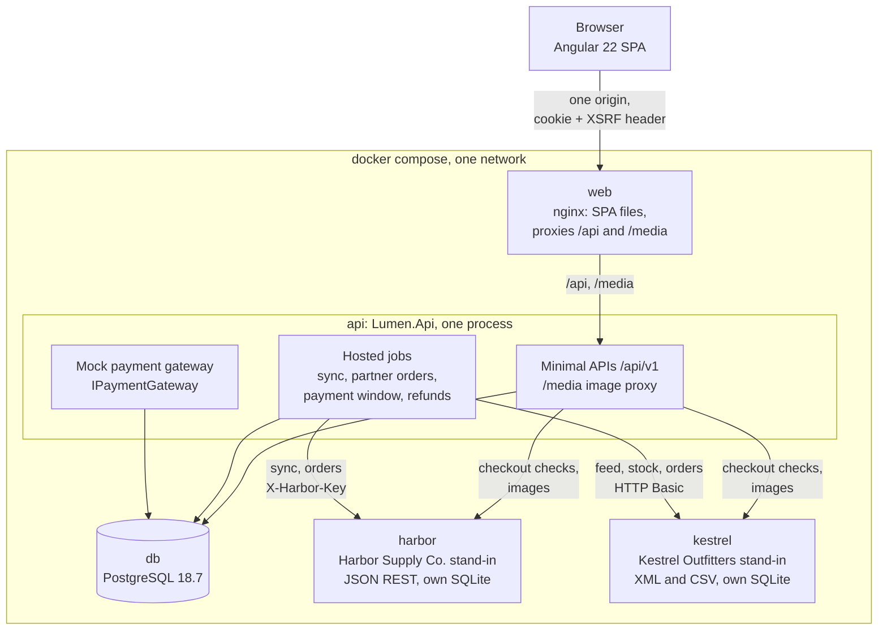
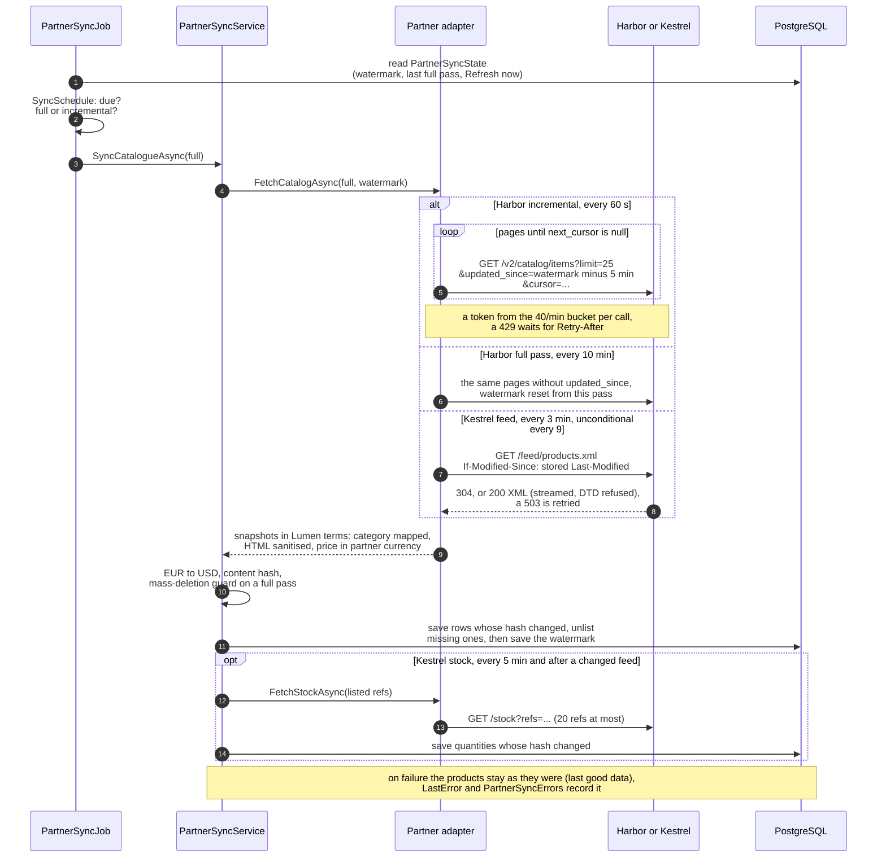
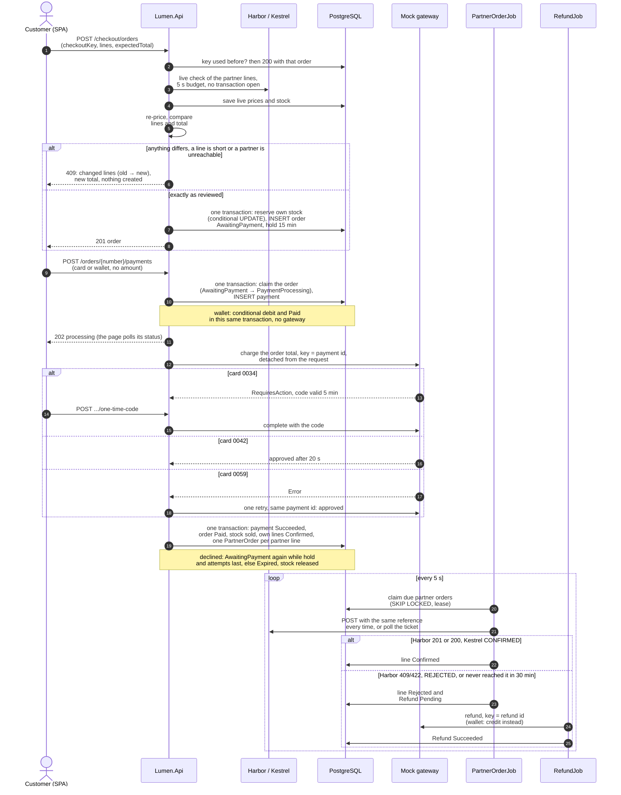
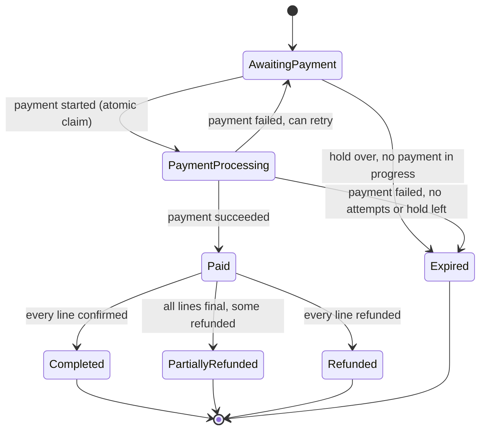

# Lumen Goods: design

How the solution is structured. The reasons for each decision are in the [ADRs](docs/adr/README.md), the rules and their tests in [BUSINESS-RULES.md][rules], and the choices made where the spec is silent in [ASSUMPTIONS.md][assumptions].

## 1. Goals and quality priorities

| # | Goal | How the design serves it |
|---|---|---|
| 1 | Correctness of money and stock | One rounding rule and one `PricingService`. The order is the price lock. Conditional `UPDATE`s backed by constraints ([0004][adr4], [0006][adr6]) |
| 2 | Partner contract fidelity | Stand-ins are separate processes with conformance tests. Lumen adapts only in its adapters. An architecture test forbids shared code ([0002][adr2]) |
| 3 | Resilience to partner outages | Pages read only Lumen's database. Partner calls have timeouts, retries and breakers. A failed sync keeps the last good data ([0003][adr3]) |
| 4 | Changeability | Feature folders on a pure domain project, one port per partner capability, validated configuration, rule IDs from code to test, §9 |
| 5 | One-command run | `docker compose up --build`: migrations and seed at start-up, health-checked start order, the same compose smoke test in CI |

## 2. Context and containers

| Service | Built from | Host port | State |
|---|---|---|---|
| `web` | `src/web/Dockerfile` (Angular build, nginx) | 8080 | none |
| `api` | `src/Lumen.Api/Dockerfile` | none | none |
| `db` | `postgres:18.7-alpine3.24` | none | volume `db-data` |
| `harbor` | `src/StandIns/HarborSupply.StandIn/Dockerfile` | 8081 | own SQLite |
| `kestrel` | `src/StandIns/KestrelOutfitters.StandIn/Dockerfile` | 8082 | own SQLite |

Ports bind to 127.0.0.1. Start order: `db` healthy, then `api` healthy (migrated and seeded), then `web`. The browser sees one origin (no CORS) and never calls a partner: the sandbox ports exist for inspection and the demo CLI ([Harbor][harbor-readme], [Kestrel][kestrel-readme]). `Partners:*:BaseUrl` can point at any implementation of the contracts.

## 3. Building blocks

`Lumen.Domain` holds the rules that need no I/O (no EF Core, no HTTP). `Lumen.Api` holds the feature folders, one `LumenDbContext` and the hosted jobs. The stand-ins reference nothing from Lumen.

| `src/Lumen.Api/` | Owns | Rules |
|---|---|---|
| `Catalog` | Product API: search, filters, sorts, paging | BR-CAT-01..03 |
| `Carts` | Guest and customer carts, notices, merge on sign-in | BR-CART-01..03 |
| `Checkout` | Preview; Place order: live checks, re-pricing, stock reservation | BR-CHK-01/02, BR-STOCK-01 |
| `Payments` | Card and wallet payments, `IPaymentGateway` and its mock, payment window and refund jobs | BR-PAY-01..07 |
| `Orders` | Order APIs, partner order job, line rejection and refunds | BR-ORD-01..04 |
| `Wallets` | Balance, log, opening balances | BR-PAY-06 |
| `Partners/Ports` | `IPartnerCatalogSource`, `IPartnerStockSource`, `IPartnerAvailabilityCheck`, `IPartnerOrderGateway` | |
| `Partners/Harbor`, `Kestrel` | One anti-corruption adapter per partner | BR-CAT-01/02 |
| `Partners/Sync` | Partner-neutral engine: schedule, hash, upsert, mass-deletion guard | BR-SYNC-01/02 |
| `Partners/Mapping`, `Http`, `Media`, `Admin` | Category map, FX, sanitiser; resilience, Harbor rate gate; image proxy; Partner status | BR-MONEY-01 |
| `Admin`, `Identity` | Own products; cookie session and roles, cart merge on sign-in, wallet on registration | BR-ADM-01, BR-CART-01, BR-PAY-06 |
| `Infrastructure` | DbContext, migrations, seeding, two-decimal JSON, XSRF filter | |

| `src/Lumen.Domain/` | Owns | Rules |
|---|---|---|
| `Money` | `MoneyMath.RoundToCents` (half away from zero) | BR-MONEY-01 |
| `Catalog` | `AvailabilityPolicy`, product sources and categories | BR-CAT-01 |
| `Pricing` | `PricingService`: tax per line, shipment per seller | BR-MONEY-02, BR-SHIP-01 |
| `Orders` | Transition tables, status derivation, `RefundCalculator` | BR-PAY-01, BR-STOCK-01, BR-ORD-01..04 |
| `Payments` | Test cards, card validation, one-time code, payment window | BR-PAY-01..05, BR-PAY-07 |

Ports keep JSON, XML and CSV out of the engine. Each adapter declares what it can do (`IncrementalChanges`, `StockInCatalogue`, `DecidesLater`) and reports failures as results or a `PartnerException`, never as unhandled errors. Hosted jobs, every 5 s unless `Jobs:Enabled=false`: `PartnerSyncJob` (one per partner), `PartnerOrderJob`, `PaymentWindowJob` (expiry, stuck payments), `RefundJob`. Card charges run in `DetachedPaymentRunner`, outside the request.

## 4. Runtime views

### (a) Catalogue sync

The content hash covers the stored result, FX rate and category map included, so a configuration change triggers a full pass that re-maps unchanged products. An empty catalogue, or one missing at least 10 listed products and over half of them, has its removals held for an admin ([0003][adr3], [BR-SYNC-01/02][rules-sync]).

### (b) Checkout, payment and partner orders

Each step claims in a short transaction, calls out with none open, then records the result. A line is refunded automatically only when the partner cannot have the order. If a send's outcome is unknown (a timeout after sending, a 5xx), or an accepted line has no decision after 24 h, it goes to an admin instead ([0004][adr4], [0005][adr5], [rules][rules-chk]).

### (c) Lifecycles

Orders, order lines, partner orders, payments and refunds each move through a transition table in `Lumen.Domain/Orders`; a move that is not in its table throws. All five state diagrams are in [Orders/README.md][orders-readme], generated from those tables and checked by `TransitionTableTests`, so they cannot drift from the code. The order's own lifecycle:

Once paid, the order's status is derived from its lines: all confirmed is Completed, all final with some refunded is PartiallyRefunded, all refunded is Refunded.

## 5. Data model

One PostgreSQL database; money is `numeric(12,2)`. The database rules out these states itself, so application code is not the only defence.

| Tables | Constraints that make bad states impossible | Why |
|---|---|---|
| `Products` | unique (`Source`, `SourceProductId`); 0 ≤ `Reserved` ≤ `OnHand`; `xmin` | Sync upsert key; no overselling (BR-STOCK-01); stale admin save gets 409 |
| `Carts`, `CartLines` | guest or customer; one line per product; quantity 1 to 10; `xmin` | Two tabs cannot overwrite each other |
| `Orders` | unique `CheckoutKey`; `Total` = sum of parts; `RefundedTotal ≤ Total` | Repeat Place order finds its order; refunds ≤ charge |
| `OrderLines`, `OrderShipments` | subtotal = price × quantity; refunded ≤ subtotal + tax; one shipment per seller | Exact per-line refunds (BR-MONEY-02, BR-SHIP-01) |
| `PartnerOrders` | unique `ExternalRef` (`{orderNo}-{line}`) | Written with Paid, so an outbox; never ordered twice (BR-ORD-01) |
| `Payments` | one non-final payment per order (partial unique index); card brand and last 4 only | One live payment (BR-PAY-01); no PAN stored (BR-PAY-02) |
| `Refunds`, `RefundLines` | one refund per order line and per shipment fee | Never refunded twice (BR-ORD-03) |
| `Wallets`, `WalletTransactions` | `Balance ≥ 0`; one movement per payment or refund | No overdraft, no double debit (BR-PAY-06) |
| `PartnerSyncStates`, `PartnerSyncErrors` | one row per partner; last 50 errors | Resume, admin status (BR-SYNC-02) |
| `MockGatewayCharges`, `MockGatewayRefunds` | key = idempotency key | The mock PSP's own records |

## 6. Crosscutting concepts

**Money** ([0006][adr6]): `decimal` USD, rounded half away from zero (never banker's), EUR converted per unit with the rate stored per line, tax per line, Kestrel's `1.249,00` parsed with an explicit `NumberFormatInfo`.

**Idempotency**: a key and a unique constraint at every step.

| Step | Key | Enforced by |
|---|---|---|
| Place order | `checkoutKey` | unique index; a repeat gets 200 with the same order |
| Payment start | the order | conditional claim; one non-final payment |
| Card charge, refund | payment id, refund id | gateway idempotency key, reused on every retry |
| Wallet move | payment id, refund id | one wallet transaction row per payment or refund; `Balance ≥ 0` |
| Partner order | `{orderNo}-{line}` | unique `ExternalRef`; Harbor 200 and Kestrel 409 mean success |
| Catalogue write | partner id, content hash | unique index; watermark moves after the save |

**Concurrency**

| Mechanism | Where |
|---|---|
| Conditional `UPDATE ... WHERE` | stock reservation, payment claim, wallet debit |
| `xmin` row versions | products, carts, orders, payments, partner orders, refunds, wallets |
| Locks in a fixed order | the order row (`FOR UPDATE`) before product rows, products by id |
| `FOR UPDATE SKIP LOCKED` + lease | partner order and refund claims |
| In-process only | sync lock and Harbor token buckets, so one replica (§10) |

**No I/O inside a transaction.** Partners and the gateway take seconds (card 0042 takes 20 s). Locks and pooled connections are never held while waiting for them.

**Resilience.** Each partner has its own `HttpClient`. Harbor allows 10 s per attempt and 90 s in total; Kestrel 15 s and 75 s. Up to 3 retries, for GETs only, back off exponentially and honour `Retry-After`. A circuit breaker opens at 50 % failures over 60 s. Harbor's budget is split: 40/min for sync, checks and orders, 10/min for images, at most 60 in any minute. POSTs are never retried by the HTTP pipeline: the order job resends with the same reference and gives up at 30 min. Place order's live checks get 5 s in total.

**Security**

- Same-origin cookie auth with `X-XSRF-TOKEN` on every non-GET call ([0008][adr8]).
- Every customer query is scoped to the signed-in customer, so another customer's order returns 404. Admin endpoints require the admin role.
- Partner HTML is sanitised on the server to an allow-list ([A-21][assumptions]). nginx and Angular add a CSP.
- XML DTDs are refused (no XXE).
- The image proxy fetches only from allow-listed origins and follows no redirects (SSRF guard).
- The card number and CVC stay in memory; only brand and last 4 digits are stored.

**Configuration over code.** Every setting a reviewer may change is an `IOptions<T>` validated at start-up, set in `src/Lumen.Api/appsettings.json` and overridable by environment variables.

**Testing**

| Layer | Project | Proves |
|---|---|---|
| Unit | `tests/Lumen.UnitTests` | domain rules, sync schedule, adapters via a stub `HttpMessageHandler`, stand-in isolation |
| Integration | `tests/Lumen.IntegrationTests` | API on Testcontainers PostgreSQL 18.7: constraints, races, auth, jobs with fake partners and clock |
| Conformance | `tests/*.StandIn.Tests` | stand-ins' raw status codes, headers and bodies against the contracts |
| Angular | `src/web` (`npm test`, `npm run lint`) | components, URL state, cart state |
| CI | `.github/workflows/ci.yml` | all of the above, then a `docker compose up --wait` smoke test |

Each rule's ID is in its code comment and its tests' names and traits, for example `BR_MONEY_01_...` with `[Trait("BR", "BR-MONEY-01")]`. `dotnet test --filter-trait "BR=BR-MONEY-01"` runs one rule, and [BUSINESS-RULES.md][rules] links each rule's tests. Time comes from `TimeProvider`, so no test sleeps.

## 7. Scale path

In two years: 150,000 visitors an hour (1.5 M in a sale hour), 100,000 orders a day, over 1 M products, over 50 partners. At 8 page views per visit and 3 calls per page, that is about 1,000 API requests/s at a normal peak and 10,000/s in a sale hour, 90 % of them catalogue reads. Orders reach 2.8/s at a normal peak and 27.8/s in a sale hour (about 420 row writes/s, within one PostgreSQL primary).

| Area | Today | At 2-year volumes | Trigger |
|---|---|---|---|
| API | One replica | Web replicas plus a jobs deployment (`Jobs:Enabled=false` on web); shared limiter, sync lease and key ring | A second replica |
| Catalogue | PostgreSQL, `OFFSET` paging | CDN cache of 30 to 60 s, read replicas, keyset paging | p95 over ~200 ms |
| Search | `ILIKE` | `pg_trgm`, then Azure AI Search | ~100,000 products |
| Images | In-memory cache | Blob storage and a CDN | A second replica |
| Own stock | Conditional `UPDATE` per row | Split stock rows for hot products; a waiting room for sales | Lock waits |
| Jobs | Rows as the queue, `SKIP LOCKED` | An outbox feeding Service Bus | Lag over 1 min |
| Harbor | Full pass every 10 min | Nightly full pass, a global limiter with priorities, checkout falling back to sync data | ~10,000 Harbor items |
| Kestrel | Whole feed, stock every 5 min | Streamed ~1 GB feed fetched less often; stock on demand plus hourly | Feed over ~100 MB |
| Partners | Two compiled adapters | Sellers as data; partner integration becomes the first separate service | 50+ partners |

**The binding business risk is Harbor's per-key limit:** 60 requests a minute at 25 items a page, at most 1,500 items a minute.

- A full pass over 1 M items is 40,000 requests: about 11 h at 60/min, 17 h at Lumen's 40/min share. A full pass, the only way to see removals, fits 10 minutes only up to about 10,000 items.
- Incremental sync scales with the rate of change. A 15-minute window holds 900 requests (600 at 40/min): at most 22,500 (15,000) changed items.
- At the normal peak, 40 % of 10,000 orders an hour have a Harbor line: about 100 POSTs a minute at one per line, over the limit before any sync.

Lumen cannot engineer this away. It needs a higher limit, more keys, or a bulk or webhook API from Harbor, so it should be raised early ([0003][adr3]).

## 8. Running it on Azure

| Piece | Azure service | Notes |
|---|---|---|
| `api`, `web` | Container Apps (or App Service) | Same images; one API replica until the §7 split; migrations move to the pipeline |
| `db` | PostgreSQL Flexible Server | Zone-redundant HA, point-in-time restore, read replica, managed identity |
| Edge | Front Door and CDN | Routes `/api` and `/media` to the API so cookies stay same-origin; caches catalogue and `/media` |
| Secrets | Key Vault | Partner and database credentials as secret references |
| Telemetry | Application Insights via OpenTelemetry | Alerts on sync age, partner-order lag, failed refunds |
| Messaging | Service Bus fed by an outbox | When the row queues outgrow PostgreSQL |
| Storage | Blob Storage | Shared Data Protection keys, product images |
| Stand-ins | Their own Container Apps | Test environments only |

## 9. Where to change X

`Api/` = `src/Lumen.Api/`, `Domain/` = `src/Lumen.Domain/`, `Unit/` = `tests/Lumen.UnitTests/`, `Int/` = `tests/Lumen.IntegrationTests/`. "Config" is `src/Lumen.Api/appsettings.json`.

| Change | Touch | Start from |
|---|---|---|
| Add a third partner | `Api/Partners/<Name>/` adapters; register in `Api/Partners/PartnersFeature.cs`, `Api/Checkout/PartnerAvailability.cs`, `Api/Orders/PartnerOrderGateways.cs`; `ProductSources` in `Domain/Catalog/CatalogVocabulary.cs`; config `Partners:<Name>`, `Catalog:Sellers`; `docker-compose.yml` | `Unit/Partners/HarborAdapterTests.cs`, `Int/Partners/PartnerSyncTests.cs` |
| Low-stock threshold | Config `Catalog:LowStockMax` | `Unit/Catalog/AvailabilityPolicyTests.cs` |
| Tax rate | Config `Pricing:TaxRate` | `Unit/Pricing/PricingServiceTests.cs` |
| Free shipping over $X | `Domain/Pricing/PricingOptions.cs`, `PricingService.Price` | `Unit/Pricing/PricingServiceTests.cs` |
| Add a test card | `Domain/Payments/CardBehaviours.cs`, `Api/Payments/MockPaymentGateway.cs` | `Unit/Payments/CardBehavioursTests.cs` |
| One-time-code expiry | Config `Payments:OneTimeCodeLifetime` | `Unit/Payments/OneTimeCodePolicyTests.cs` |
| FX rate | Config `Fx:EurToUsd` | `Unit/Partners/SyncPolicyTests.cs` |
| Map a partner category | Config `Partners:Kestrel:CategoryMap` | `Unit/Partners/KestrelAdapterTests.cs` |
| Add a product field | `Api/Catalog/Product.cs`, `ProductConfiguration.cs`, `ProductDto.cs`, a migration; `Api/Partners/Sync/ProductContent.cs` | `Unit/Catalog/ProductDtoTests.cs` |
| Add a sort option | `Api/Catalog/ProductSearch.cs`; `src/web/src/app/core/api/products.api.ts` | `Unit/Catalog/ProductSearchCriteriaTests.cs` |
| Order cancellation | `Domain/Orders/Statuses.cs`, `OrderTransitions.cs`, `Api/Orders/OrderEndpoints.cs`, `Api/Payments/OrderPaymentWriter.cs` | `Unit/Orders/OrderTransitionTests.cs` |
| Partner give-up timeout | Config `PartnerOrders:GiveUpAfter` | `Unit/Orders/PartnerOrderScheduleTests.cs` |
| Harbor rate budget | Config `Partners:Harbor:RateLimit` | `Unit/Partners/HarborAdapterTests.cs` |
| Sync intervals | Config `Partners:*:CatalogueInterval`, `FullSyncInterval`, `StockInterval` | `Unit/Partners/SyncPolicyTests.cs` |
| Price hold, attempts | Config `Payments:OrderHold`, `MaxAttemptsPerOrder` | `Unit/Payments/PaymentWindowPolicyTests.cs` |

## 10. Trade-offs and known limits

- **One API replica**: limiters, the sync lock, the image cache and Data Protection keys live in the process ([0002][adr2]).
- **Charge then refund**: a card is charged for lines a partner may reject. A real PSP would authorize and capture ([0005][adr5]).
- **One partner order per line**: a Kestrel rejection hits exactly one line, at the cost of more partner calls ([0005][adr5]).
- **Partner stock is checked, not held**: if it runs out before the partner order, the line is refunded ([0004][adr4]).
- **Strict re-confirmation**: a price drop also sends the customer back to confirm.
- **PostgreSQL search**: `ILIKE` with `OFFSET` paging lasts to about 100,000 products.
- **In-memory image cache**: lost on restart; refilling it spends Harbor's image budget.
- **Partners that never answer**: after 30 min a line is refunded only if no send can have reached the partner; an unknown outcome, or an accepted line undecided after 24 h, goes to an admin, because a refunded line that still ships loses the goods.

[adr2]: docs/adr/0002-modular-monolith-in-one-api-host.md
[adr3]: docs/adr/0003-partner-integration-adapters-sync-image-proxy.md
[adr4]: docs/adr/0004-checkout-consistency-the-order-is-the-price-lock.md
[adr5]: docs/adr/0005-payments-charge-then-refund-one-partner-order-per-line.md
[adr6]: docs/adr/0006-money-fx-tax-and-shipping.md
[adr8]: docs/adr/0008-same-origin-cookie-auth-with-xsrf-validation.md
[rules]: docs/BUSINESS-RULES.md
[rules-sync]: docs/BUSINESS-RULES.md#catalogue-and-sync
[rules-chk]: docs/BUSINESS-RULES.md#checkout-and-stock
[assumptions]: docs/ASSUMPTIONS.md
[orders-readme]: src/Lumen.Domain/Orders/README.md
[harbor-readme]: src/StandIns/HarborSupply.StandIn/README.md
[kestrel-readme]: src/StandIns/KestrelOutfitters.StandIn/README.md
