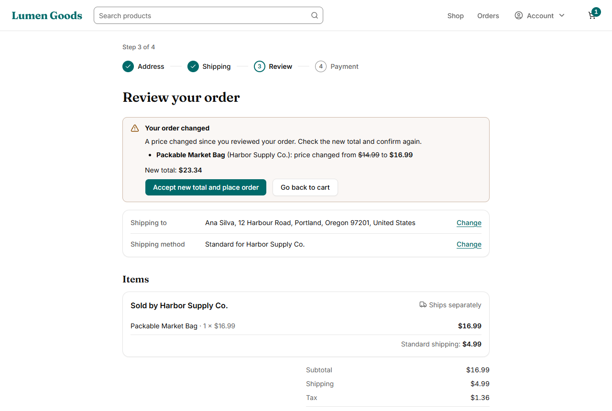
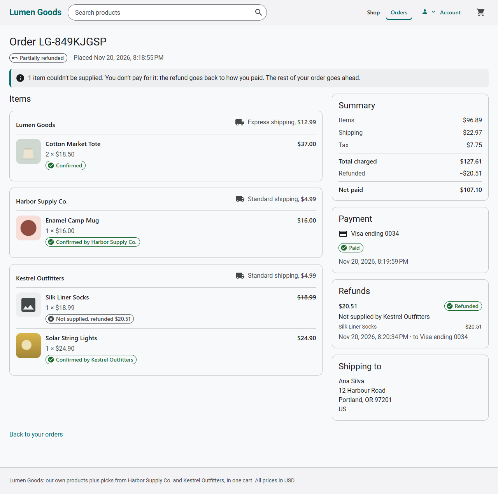

# Lumen Goods

One online shop that sells Lumen Goods' own products and resells products from two partner shops,
Harbor Supply Co. (JSON REST) and Kestrel Outfitters (XML feed, CSV stock, asynchronous XML orders):
one catalogue, one cart, one payment, one order, and every item followed to the end.

Angular 22 storefront and admin · ASP.NET Core 10 API with EF Core and PostgreSQL 18 · two partner stand-ins ·
mock card gateway and wallet · `docker compose up` runs all of it.

| | |
|---|---|
|  |  |
|  |  |

## Run it

Prerequisite: Docker (Docker Desktop on Windows/macOS). From the repository root:

```bash
docker compose up --build
```

The first build downloads images and packages and takes a few minutes; later starts take seconds.
Migrations and seed data run at start-up. Everything listens on `127.0.0.1` only.

| What | URL | Credentials |
|---|---|---|
| Storefront and admin | http://localhost:8080 | see below |
| API reference (Scalar) | http://localhost:8080/api/docs | |
| Harbor Supply Co. sandbox | http://localhost:8081 | header `X-Harbor-Key: harbor-dev-key-123` |
| Kestrel Outfitters sandbox | http://localhost:8082 | HTTP Basic `lumen` / `kestrel-secret` |

Ports can be changed with `WEB_PORT`, `HARBOR_PORT` and `KESTREL_PORT` (see `.env.example`).
Reset all data: `docker compose down --volumes`.

### Seeded accounts

| Role | Email | Password |
|---|---|---|
| Customer (wallet $2,000.00) | `customer@lumengoods.test` | `Customer!2026` |
| Admin | `admin@lumengoods.test` | `Admin!2026` |

New registrations start with a $500.00 wallet.

## A five-minute tour

1. **Shop.** Search, filter by category, seller, price or stock, and sort. The URL keeps the state. Products from all
   three shops sit side by side, in USD (Kestrel's EUR prices are converted).
2. **Cart.** Add items from all three shops and sign in: a guest cart merges into the account. Each shop is its own
   shipment. If a partner changes a price or stock, the line says so.
3. **Checkout.** Address, then shipping per shop (Express only for Lumen's own items), then review, then pay.
   If anything changed since the review, Place order stops and shows old → new.
4. **Pay** by card or wallet. Any name, a future expiry and any 3-digit CVC:

   | Card | Result |
   |---|---|
   | 4111 1111 1111 1111 | Approved |
   | 4242 0000 0000 0018 | Declined: insufficient funds |
   | 4242 0000 0000 0026 | Declined: card reported stolen (the customer sees a generic decline, the admin the reason) |
   | 4242 0000 0000 0034 | Asks for a one-time code: `123456` approves, anything else declines, expires after 5 minutes |
   | 4242 0000 0000 0042 | "Confirming your payment…" for 20 seconds, then approved; refreshing is safe |
   | 4242 0000 0000 0059 | Gateway error, retried once automatically with the same payment, then approved; one charge |
   | Any other Luhn-valid number | Approved |

5. **Follow the order** on *Orders*. Partner lines move from "Awaiting …" to "Confirmed by …". To see a partner
   fail to supply part of a paid order, set a Kestrel item's stock to 0 after Place order, before paying:

   ```bash
   docker compose exec kestrel dotnet KestrelOutfitters.StandIn.dll list
   docker compose exec kestrel dotnet KestrelOutfitters.StandIn.dll set-stock K-7735 0
   ```

   That line becomes "Not supplied, refunded $X" (the line and its tax; the shipment fee too if nothing else ships
   from that shop); the rest of the order goes ahead.
6. **Admin** (sign in as the admin): orders with payment events and partner orders, a "needs attention" filter,
   own products (price and stock), and partner sync status with *Refresh now*.

Every other scenario (price changes, removed products, Harbor commands) is in the
[demo-scenarios skill](.agents/skills/demo-scenarios/SKILL.md).

## Where each requirement is met

| Requirement | Where to see it | Rules and tests |
|---|---|---|
| Search, filters, sort and paging, kept in the URL | Catalogue | BR-CAT-03 |
| One cart across three shops, one payment | Cart, checkout | BR-CART-01..03, BR-SHIP-01, BR-PAY-01 |
| Prices in USD; Kestrel's EUR converted | Catalogue, cart | BR-MONEY-01 |
| Shipping and sales tax on the order | Checkout review, order | BR-MONEY-02, BR-SHIP-01 |
| Never pay a price not seen | Cart notices, "Your order changed" at Place order | BR-CART-02, BR-CHK-01 |
| Never pay for what can't be supplied | Live partner check at Place order; refund after payment | BR-CHK-02, BR-ORD-03 |
| Never charged twice | Checkout key, payment claim, gateway idempotency | BR-PAY-01, BR-PAY-04, BR-PAY-05 |
| Each test card behaves as listed | Payment page | BR-PAY-02..05, BR-PAY-07 |
| Wallet pays for an order | Payment page, refunds credit it | BR-PAY-06 |
| Follow the status of every item | Order page, per line | BR-ORD-02, BR-ORD-04 |
| Own stock never oversold | Reserved at Place order, released on expiry | BR-STOCK-01, BR-ADM-01 |
| Keep working when a partner is slow or down | Pages read Lumen's database; partner status page | BR-SYNC-02, BR-ORD-04 |
| Partner changes visible within 15 minutes | Harbor every 60 s, Kestrel feed every 3 min | BR-SYNC-01 |

Each rule, its scenarios and links to its tests: [docs/BUSINESS-RULES.md](docs/BUSINESS-RULES.md).

## Tests

```bash
dotnet test --solution LumenGoods.slnx                              # all .NET tests; integration tests need Docker
dotnet test --solution LumenGoods.slnx --filter-trait "BR=BR-PAY-05"  # the tests for one business rule
cd src/web && npm ci && npm test                                    # Angular unit tests
```

| Suite | What it proves |
|---|---|
| `tests/Lumen.UnitTests` | Domain rules (money, pricing, transitions, card behaviours), partner adapters against stub HTTP, sync policies, architecture (stand-ins share no code) |
| `tests/Lumen.IntegrationTests` | The real API on PostgreSQL 18 (Testcontainers): constraints, races (two payments, last unit, double click), jobs with fake partners and a fake clock |
| `tests/*.StandIn.Tests` | Each stand-in's raw status codes, headers and bodies against its partner contract |
| `src/web` (Vitest) | Components, URL state, cart and checkout state, payment page states |

CI (`.github/workflows/ci.yml`) runs all of them plus a `docker compose up` smoke test on every pull request that
changes code (docs-only pull requests skip it).

Prerequisites for running the tests outside Docker: .NET SDK 10.0.404 (`global.json`), Node.js 26.13 or later, and
Docker running (the integration tests start PostgreSQL with Testcontainers).

## Exact versions

| Component | Version |
|---|---|
| .NET SDK / runtime | 10.0.404 / 10.0.15 (LTS), C# 14 |
| ASP.NET Core, EF Core, Identity | 10.0.15 |
| Npgsql EF Core provider | 10.0.3 |
| PostgreSQL | 18.7 |
| Angular, Angular Material | 22.3.0 |
| TypeScript / Node.js | 6.0.3 / 26.13.1 (LTS) |
| nginx | 1.30.6 (unprivileged image) |
| xUnit v3 / Testcontainers | 4.0.3 / 4.17.0 |

Every NuGet version is pinned in `Directory.Packages.props`, npm versions in `src/web/package-lock.json`.
Why .NET 10 LTS and PostgreSQL 18 rather than the newest majors: [ADR 0007](docs/adr/0007-dotnet-10-lts-and-postgresql-18.md).

## Assumptions

The spec leaves some things open; each reading is listed with an ID in [docs/ASSUMPTIONS.md](docs/ASSUMPTIONS.md).
The ones that shape behaviour most:

| ID | Assumption |
|---|---|
| A-51 | One launch country, the US (USD prices, "sales tax", US sample addresses) |
| A-01, A-02 | One configurable sales tax rate (8 %) on product lines, partner items included; shipping is not taxed |
| A-05 | Shipping per seller shipment: Standard $4.99; Express $12.99 only for Lumen's own items |
| A-07, A-08 | EUR→USD at a configured 1.0850 per unit price, rounded half away from zero |
| A-09 | Any price change between review and Place order, up or down, asks the customer to confirm again |
| A-42 | Placing the order holds its prices and reserves own stock for 15 minutes |
| A-43 | A partner that never accepts within 30 minutes: refunded if it cannot have the order, otherwise an admin decides |
| A-44 | No cancellation after payment (partners offer none) |

## Known limits

- **Kestrel prices are as fresh as its feed** (synced every 3 minutes). Place order checks Harbor's price and stock
  and Kestrel's stock live, but Kestrel has no per-item price endpoint ([ADR 0004](docs/adr/0004-checkout-consistency-the-order-is-the-price-lock.md)).
- **Charge, then refund** what a partner can't supply, because the mock gateway has no separate authorise and
  capture ([ADR 0005](docs/adr/0005-payments-charge-then-refund-one-partner-order-per-line.md)).
- **One API replica**: rate limiters, the sync lock and the image cache live in the process. The path to the
  two-year volumes is in [DESIGN.md §7](DESIGN.md#7-scale-path).

## Documentation

| Read | For |
|---|---|
| [DESIGN.md](DESIGN.md) | Structure, flows, data model, idempotency and concurrency, scale path, Azure, where to change what |
| [docs/adr/](docs/adr/README.md) | Why each significant decision was made, with the alternatives |
| [docs/BUSINESS-RULES.md](docs/BUSINESS-RULES.md) | Every rule with Given/When/Then scenarios and links to its tests |
| [docs/ASSUMPTIONS.md](docs/ASSUMPTIONS.md) | How the gaps in the spec were filled |
| [docs/AI-USAGE.md](docs/AI-USAGE.md) | How AI was used, what a person decided, and where AI was wrong |
| [AGENTS.md](AGENTS.md), [.agents/skills/](.agents/skills) | Instructions and skills for coding agents (and humans) working in this repo |
| [Harbor](src/StandIns/HarborSupply.StandIn/README.md), [Kestrel](src/StandIns/KestrelOutfitters.StandIn/README.md) stand-ins | Each partner's contract as implemented, and its demo CLI |

## Working on it

Changes land through pull requests with CI. Local git hooks give the same signal earlier:

```bash
git config core.hooksPath .githooks   # once per clone: Conventional Commit check + fast pre-push tests
```

| Path | What |
|---|---|
| `src/Lumen.Api` | Back end: minimal APIs, EF Core, hosted jobs, mock payment gateway |
| `src/Lumen.Domain` | Pure domain code: money, pricing, refunds, status transitions |
| `src/web` | Storefront and admin (Angular) |
| `src/StandIns/*` | The two partner stand-ins, each with its own SQLite database |
| `tests/` | xUnit v3 test projects |
| `docs/` | ADRs, business rules, assumptions, AI usage |
