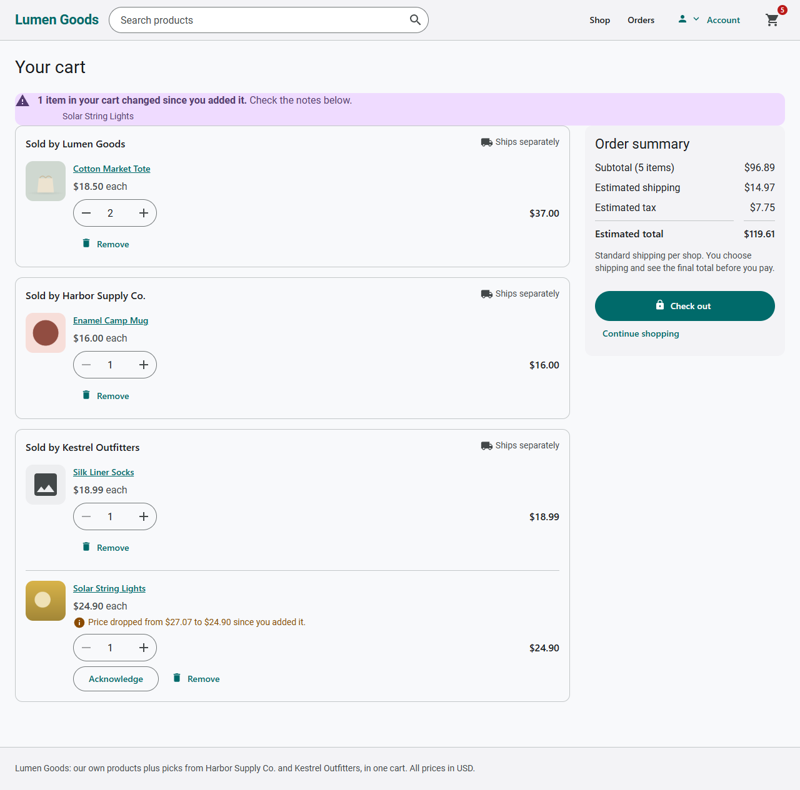
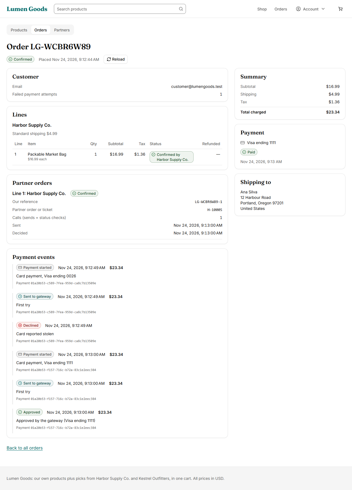
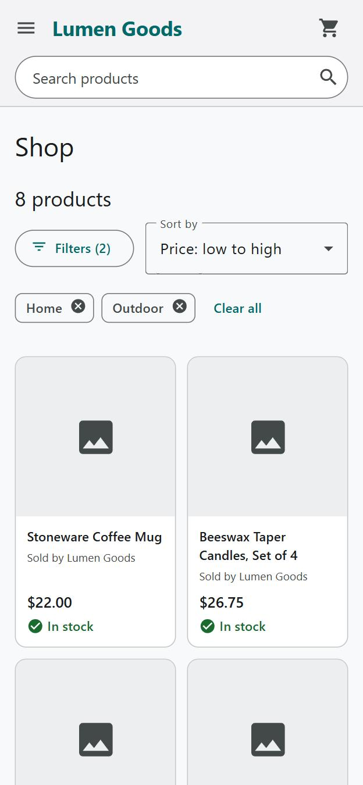
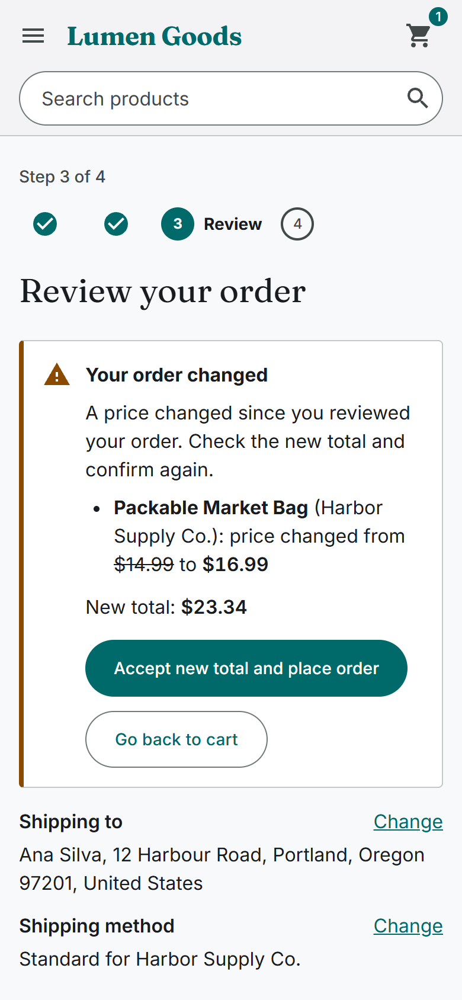
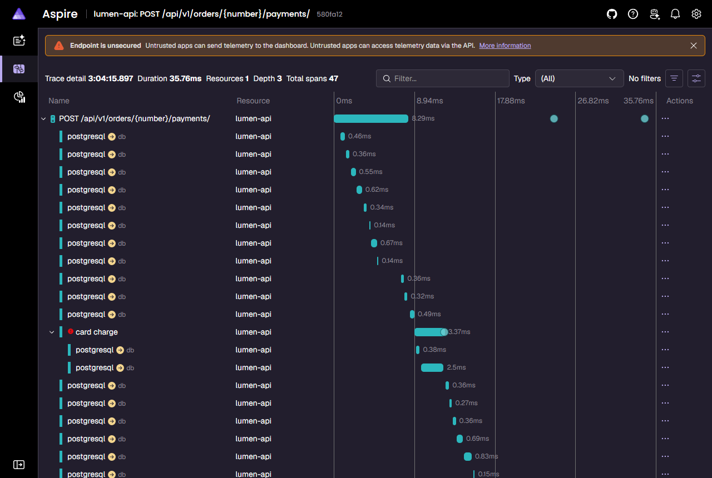

# Lumen Goods

One online shop that sells Lumen Goods' own products and resells products from two partner shops,
Harbor Supply Co. (JSON REST) and Kestrel Outfitters (XML feed, CSV stock, asynchronous XML orders):
one catalogue, one cart, one payment, one order, and every item followed to the end.

Angular 22 storefront and admin · ASP.NET Core 10 API with EF Core and PostgreSQL 18 · two partner stand-ins ·
mock card gateway and wallet · `docker compose up` runs all of it.

| | |
|---|---|
|  |  |
|  |  |

At phone width:

 

## Reviewing in 15 minutes

1. [`PlaceOrderService.cs`](src/Lumen.Api/Checkout/PlaceOrderService.cs): `PlaceAsync` checks partners live with no transaction open, re-prices (any change is a 409), then reserves own stock with conditional `UPDATE`s.
2. [`PaymentService.cs`](src/Lumen.Api/Payments/PaymentService.cs), [`CardChargeProcess.cs`](src/Lumen.Api/Payments/CardChargeProcess.cs), [`MockPaymentGateway.cs`](src/Lumen.Api/Payments/MockPaymentGateway.cs): an atomic claim, the payment id as gateway key, and card 0059's one retry that still charges once.
3. [`PartnerOrderProcessor.cs`](src/Lumen.Api/Orders/PartnerOrderProcessor.cs): one partner order per line; at 30 minutes a line is refunded only if no send can have reached the partner, else an admin decides.
4. [`RefundCalculator.cs`](src/Lumen.Domain/Orders/RefundCalculator.cs): exact refunds: the line and its tax, plus the shipping fee only when nothing else ships from that seller.
5. [`OwnStockRaceTests.cs`](tests/Lumen.IntegrationTests/Checkout/OwnStockRaceTests.cs): 50 customers race for 7 units on real PostgreSQL; exactly 7 orders, and reserved never exceeds on hand.
6. [`docs/BUSINESS-RULES.md`](docs/BUSINESS-RULES.md): every rule with Given/When/Then scenarios and links to its tests.

## Deviations from the brief

- .NET 10 LTS and PostgreSQL 18, not the newest majors, whose ecosystems are not stable yet ([ADR 0007](docs/adr/0007-dotnet-10-lts-and-postgresql-18.md)).
- Open questions answered with written assumptions, not emails ([ASSUMPTIONS.md](docs/ASSUMPTIONS.md)).
- The payment gateway is a mock inside the API process, behind `IPaymentGateway` ([ADR 0005](docs/adr/0005-payments-charge-then-refund-one-partner-order-per-line.md)).
- Kestrel prices are as fresh as its 3-minute feed: it has no per-item price endpoint, so Place order checks only its stock live ([ADR 0004](docs/adr/0004-checkout-consistency-the-order-is-the-price-lock.md)).
- Lumen's share of Harbor's rate limit (40 a minute, bursts of 5) fits 6 live item checks in Place order's 5 s: beyond 6 Harbor lines, the rest are ordered on a Harbor sync at most 2 minutes old (BR-CHK-02); a partner that then can't supply is refunded (BR-ORD-03).

What I would change next, and when: [DESIGN.md §10](DESIGN.md#10-decisions-id-revisit).

## Run it

Prerequisite: Docker (Docker Desktop on Windows/macOS). From the repository root:

```bash
docker compose up --build
```

The first build takes a few minutes; later starts take seconds. Migrations and seed data run at start-up.
Everything listens on `127.0.0.1` only.

| What | URL | Credentials |
|---|---|---|
| Storefront and admin | http://localhost:8080 | see below |
| API reference (Scalar) | http://localhost:8080/api/docs | |
| Harbor Supply Co. sandbox | http://localhost:8081 | header `X-Harbor-Key: harbor-dev-key-123` |
| Kestrel Outfitters sandbox | http://localhost:8082 | HTTP Basic `lumen` / `kestrel-secret` |

Ports: `WEB_PORT`, `HARBOR_PORT`, `KESTREL_PORT`; if a VPN already uses the network `172.16.87.0/24`, set
`LUMEN_NETWORK_PREFIX` (all in `.env.example`). Reset all data: `docker compose down --volumes`.

### Seeded accounts

| Role | Email | Password |
|---|---|---|
| Customer (wallet $2,000.00) | `customer@lumengoods.test` | `Customer!2026` |
| Admin | `admin@lumengoods.test` | `Admin!2026` |

New registrations start with a $500.00 wallet.

### Test cards

Any name, a future expiry and any 3-digit CVC (4 digits for Amex). After a decline, pay the same order again with another card or the
wallet: a customer can hold at most 3 unpaid orders at a time (BR-CHK-03), and each unpaid order is released after 15 minutes.

| Card | Result |
|---|---|
| 4111 1111 1111 1111 | Approved |
| 4242 0000 0000 0018 | Declined: insufficient funds |
| 4242 0000 0000 0026 | Declined: card reported stolen (the customer sees a generic decline, the admin the reason) |
| 4242 0000 0000 0034 | Asks for a one-time code: `123456` approves, anything else declines, expires after 5 minutes |
| 4242 0000 0000 0042 | "Confirming your payment…" for 20 seconds, then approved; refreshing is safe |
| 4242 0000 0000 0059 | Gateway error, retried once automatically with the same payment, then approved; one charge |
| Any other Luhn-valid number | Approved |

## A five-minute tour

1. **Shop.** Search, filter (category, seller, price, stock) and sort; the URL keeps the state. All three shops'
   products appear together in USD (Kestrel's EUR converted).
2. **Cart.** Add items from all three shops and sign in: a guest cart merges into the account. Each shop is its own
   shipment. If a partner changes a price or stock, the line says so.
3. **Checkout.** Address, shipping per shop (Express only for Lumen's own items), review, pay.
   If anything changed since the review, Place order stops and shows old → new.
4. **Pay** by card (test cards above) or wallet.
5. **Follow the order** on *Orders*: partner lines move from "Awaiting …" to "Confirmed by …". To see a partner
   fail to supply a paid line, set a Kestrel item's stock to 0 after Place order, before paying:

   ```bash
   docker compose exec kestrel dotnet KestrelOutfitters.StandIn.dll list
   docker compose exec kestrel dotnet KestrelOutfitters.StandIn.dll set-stock K-7735 0
   ```

   That line becomes "Not supplied, refunded $X" (the line and its tax, plus the shipment fee if nothing else ships
   from that shop); the rest of the order goes ahead.
6. **Admin** (sign in as the admin): http://localhost:8080/admin/orders lists orders with payment events and partner
   orders and a "needs attention" filter; http://localhost:8080/admin/products edits own products' price and stock;
   http://localhost:8080/admin/partners shows partner sync status with *Refresh now*.

More scenarios (price changes, removed products, Harbor): the [demo-scenarios skill](.agents/skills/demo-scenarios/SKILL.md).

## Where each requirement is met

| Requirement | Where to see it | [Rules and tests](docs/BUSINESS-RULES.md) |
|---|---|---|
| Search, filters, sort and paging, kept in the URL | Catalogue | BR-CAT-03 |
| One cart across three shops, one payment | Cart, checkout | BR-CART-01..03, BR-SHIP-01, BR-PAY-01 |
| Prices in USD; Kestrel's EUR converted | Catalogue, cart | BR-MONEY-01 |
| Shipping and sales tax on the order | Checkout review, order | BR-MONEY-02, BR-SHIP-01 |
| Never pay a price not seen | Cart notices, "Your order changed" at Place order | BR-CART-02, BR-CHK-01 |
| Never pay for what can't be supplied | Live partner check at Place order; refund after payment | BR-CHK-02, BR-ORD-03 |
| Never charged twice | Checkout key, payment claim, gateway idempotency | BR-PAY-01, BR-PAY-04, BR-PAY-05 |
| Each test card behaves as listed | Payment page | BR-PAY-02..05, BR-PAY-07 |
| Wallet pays for an order | Payment page, refunds credit it | BR-PAY-06 |
| Follow the status of every item | Order page, per line | BR-ORD-02, BR-ORD-04 |
| Own stock never oversold | Reserved at Place order, released on expiry | BR-STOCK-01, BR-ADM-01 |
| Keep working when a partner is slow or down | Pages read Lumen's database; partner status page | BR-SYNC-02, BR-ORD-04 |
| Partner changes visible within 15 minutes | Harbor every 60 s, Kestrel feed every 3 min | BR-SYNC-01 |

## Tests

```bash
dotnet test --solution LumenGoods.slnx                              # all .NET tests; integration tests need Docker
dotnet test --solution LumenGoods.slnx --filter-trait "BR=BR-PAY-05"  # the tests for one business rule
cd src/web && npm ci && npm test                                    # Angular unit tests
```

End to end, against a running stack (`docker compose up --build -d --wait`): a customer buys from all three sellers
with card 0059 and the order completes; a wallet payment lowers the balance by exactly the total. Each run registers
a new customer, so the seeded customer's cart and wallet stay as you left them. Without `LUMEN_E2E_URL` these tests
are skipped; CI runs them in the compose job.

```bash
dotnet test --project tests/Lumen.EndToEndTests -e LUMEN_E2E_URL=http://localhost:8080   # bash and PowerShell alike
```

Browser tests ([Playwright](src/web/e2e), Chromium at desktop and phone width) drive the same stack through the UI:
catalogue state in the URL, a checkout across three shops, the one-time code, a declined card then the wallet, a price
change at Place order, and the admin pages. They also register their own customer. The price-change test edits Harbor
with `docker compose exec`, so it runs only when `E2E_COMPOSE=1` is set, as in CI.

```bash
cd src/web && npx playwright install chromium && npm run e2e   # http://localhost:8080 unless E2E_BASE_URL is set
```

A load test ([k6](tests/load/catalogue.js)) sends catalogue, search and product requests through nginx at a fixed
rate, and fails when p95 goes over 200 ms, more than 1 % of requests fail, or more than 0.1 % can't be sent on time. Results and the Azure sizing that
follows from them: [DESIGN.md §7–8](DESIGN.md#7-scale-path).

```bash
docker compose run --rm k6                              # 300 requests/s for 1 minute
docker compose run --rm -e RATE=2000 -e DURATION=2m k6  # bash and PowerShell alike
```

What each suite proves (the integration tests run the real API on PostgreSQL 18): [DESIGN.md §6](DESIGN.md#6-crosscutting-concepts).
CI runs them all plus a `docker compose up` smoke test on every pull request that changes code. Outside Docker you
need .NET SDK 10.0.404 (`global.json`), Node.js 26.13 or later, and Docker running.

## Seeing what it does

OpenTelemetry traces, metrics and logs can go to a local Aspire dashboard. Nothing is exported unless you ask:

```bash
OTEL_EXPORTER_OTLP_ENDPOINT=http://aspire-dashboard:18889 docker compose --profile observability up --build
```

```powershell
$env:OTEL_EXPORTER_OTLP_ENDPOINT='http://aspire-dashboard:18889'; docker compose --profile observability up --build
```

Open http://localhost:18888, pay with card 4242 0000 0000 0059, and open the `POST /api/v1/orders/{number}/payments`
trace: the first try errors, the automatic retry is approved, each with its SQL.



## Changing it live

Hot reload for the API and web app against the compose database and stand-ins:

```bash
docker compose -f docker-compose.yml -f compose.dev.yaml up --build -d   # also publishes API :5080, PostgreSQL :5432
docker compose -f docker-compose.yml -f compose.dev.yaml stop api        # frees 5080 for your own API
# second terminal; the compose stand-ins listen on 8081 and 8082
Partners__Harbor__BaseUrl=http://127.0.0.1:8081 Partners__Kestrel__BaseUrl=http://127.0.0.1:8082 dotnet watch --project src/Lumen.Api
# third terminal: http://localhost:4200 proxies /api and /media to 127.0.0.1:5080
cd src/web && npm ci && npm start
```

The second terminal in PowerShell:

```powershell
$env:Partners__Harbor__BaseUrl='http://127.0.0.1:8081'; $env:Partners__Kestrel__BaseUrl='http://127.0.0.1:8082'; dotnet watch --project src/Lumen.Api
```

Partner images synced by the container API show placeholders in this loop: their stored URLs point at `harbor:8080`
and `kestrel:8080`, and your API fetches images only from the partner URLs it was given (`127.0.0.1:8081` and `:8082`).
Press *Refresh now* for both partners on http://localhost:4200/admin/partners; the full pass stores URLs your API can
fetch. Do the same after switching back to the container API.

Once per clone, `git config core.hooksPath .githooks` adds the Conventional Commit check and fast pre-push tests.

## Libraries and why

| Library | Why |
|---|---|
| ASP.NET Core minimal APIs | One route group per feature with `TypedResults`, so the OpenAPI document comes from the handlers; no controller layer to maintain |
| PostgreSQL 18 | A real database, not the JSON files the brief allows: unique indexes, check constraints, conditional updates and row locks make "never charged twice" and "never oversold" database rules. MongoDB was weighed; it fits the catalogue's read side at scale, not the money ([ADR 0009](docs/adr/0009-postgresql-for-orders-and-stock-where-mongodb-fits.md)) |
| EF Core with Npgsql | Migrations, LINQ and change tracking for the ordinary work, plain SQL where it matters (the conditional stock `UPDATE`); Npgsql is the standard PostgreSQL driver and EF Core provider |
| ASP.NET Identity | Password hashing, lockout and the session cookie from the framework, not hand-rolled ([ADR 0008](docs/adr/0008-same-origin-cookie-auth-with-xsrf-validation.md)) |
| HtmlSanitizer | Partner descriptions are untrusted HTML; an allow-list over a real HTML parser, not regular expressions |
| CsvHelper | Kestrel's `;`-separated stock CSV, read by header name with invariant number parsing |
| Microsoft.Extensions.Http.Resilience | Polly v8 pipelines per partner client (timeouts, retries that honour `Retry-After`, circuit breaker), all from configuration |
| Scalar | The API reference at `/api/docs`, over the OpenAPI document ASP.NET Core 10 generates itself |
| OpenTelemetry | Vendor-neutral traces, metrics and logs over OTLP: the Aspire dashboard locally, any backend in production |
| Angular with Angular Material | Router, typed forms and an HTTP client with XSRF support in one framework; Material gives accessible components and an M3 theme |
| Ultracite (ESLint, Prettier, Stylelint) | One maintained preset for linting and formatting, template accessibility rules included, instead of hand-tuned configs |
| xUnit v3 with Microsoft.Testing.Platform | Current xUnit; dynamic skip lets the end-to-end tests skip without a stack; `dotnet test` on the new test platform (`global.json`) |
| AwesomeAssertions | Readable assertions; the Apache 2.0 fork of FluentAssertions, which needs a paid licence for commercial use from v8 |
| Testcontainers | Integration tests on real PostgreSQL 18, so constraints, row locks and races behave as in production |
| CsCheck | Property-based tests: the money rules hold for thousands of random carts, not only the worked examples |

Licences mattered: everything that ships is open source under a permissive licence (MIT, Apache 2.0, BSD, MS-PL or the
PostgreSQL licence). MediatR, AutoMapper, MassTransit and FluentAssertions are left out because they moved to
commercial licences; handlers and mapping are written by hand.

## Exact versions

| Component | Version |
|---|---|
| .NET SDK / runtime | 10.0.404 / 10.0.15 (LTS), C# 14 |
| ASP.NET Core, EF Core, Identity | 10.0.15 |
| Npgsql EF Core provider | 10.0.3 |
| PostgreSQL | 18.7 |
| Angular, Angular Material | 22.3.0 |
| TypeScript / Node.js | 6.0.3 / 26.13.1 (LTS) |
| nginx | 1.30.7 (unprivileged image) |
| xUnit v3 / Testcontainers | 4.0.3 / 4.17.0 |

Every NuGet version is pinned in `Directory.Packages.props`, npm versions in `src/web/package-lock.json`.

## Assumptions

[docs/ASSUMPTIONS.md](docs/ASSUMPTIONS.md) lists each, with an ID. The ones that shape behaviour most:

| ID | Assumption |
|---|---|
| A-51 | One launch country, the US (USD prices, "sales tax", US sample addresses) |
| A-01, A-02 | One configurable sales tax rate (8 %) on product lines, partner items included; shipping is not taxed |
| A-05 | Shipping per seller shipment: Standard $4.99; Express $12.99 only for Lumen's own items |
| A-07, A-08 | EUR→USD at a configured 1.0850 per unit price, rounded half away from zero |
| A-09 | Any price change between review and Place order, up or down, asks the customer to confirm again |
| A-42 | Placing the order holds its prices and reserves own stock for 15 minutes |
| A-43 | A partner that never accepts within 30 minutes: refunded if it cannot have the order, otherwise an admin decides |
| A-44 | No cancellation after payment (partners offer none) |

## Documentation

| Read | For |
|---|---|
| [DESIGN.md](DESIGN.md) | Structure, flows, data model, concurrency, scale path, Azure, where to change what, decisions I'd revisit |
| [docs/adr/](docs/adr/README.md) | Why each significant decision was made, with the alternatives |
| [docs/BUSINESS-RULES.md](docs/BUSINESS-RULES.md) | Every rule with its scenarios and tests |
| [docs/ASSUMPTIONS.md](docs/ASSUMPTIONS.md) | How the gaps in the spec were filled |
| [docs/AI-USAGE.md](docs/AI-USAGE.md) | How AI was used, what a person decided, and where AI was wrong |
| [AGENTS.md](AGENTS.md), [.agents/skills/](.agents/skills) | Layout, rules and skills for coding agents and humans |
| [Harbor](src/StandIns/HarborSupply.StandIn/README.md), [Kestrel](src/StandIns/KestrelOutfitters.StandIn/README.md) stand-ins | Each partner's contract as implemented, and its demo CLI |
