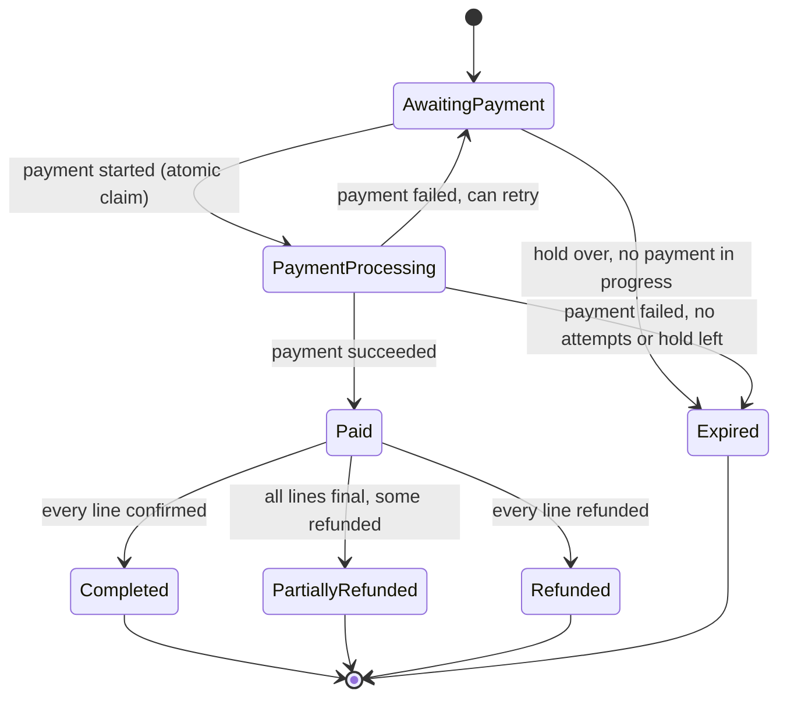
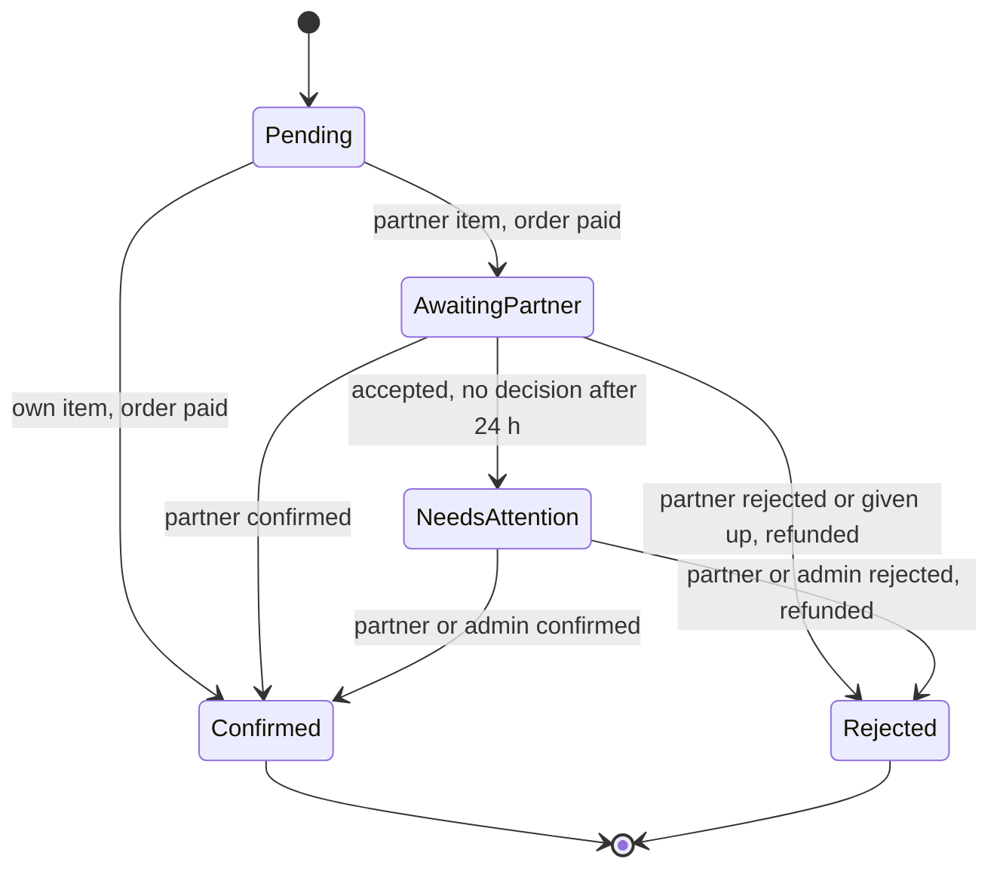
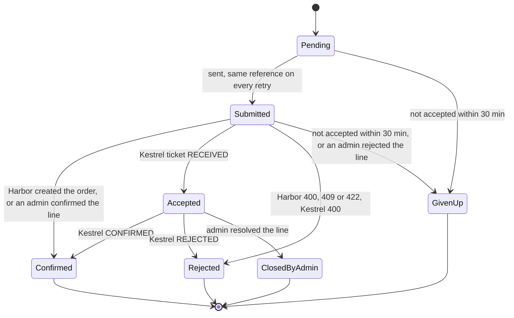
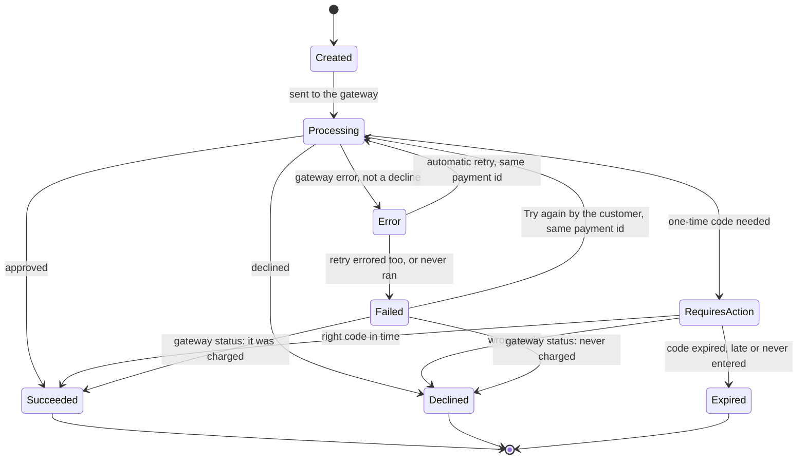
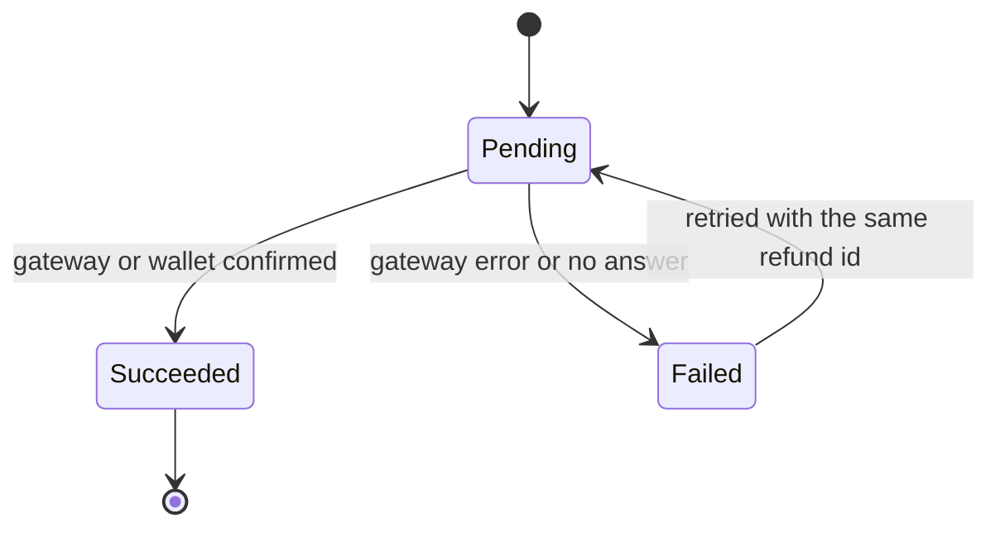

# Order, line, partner order and payment lifecycles

Every status change in Lumen Goods goes through a `TransitionTable<TState>` (`src/Lumen.Domain/TransitionTable.cs`):
`table.Move(from, to)` returns the new status or throws `InvalidOperationException` for a change the table does not list.
The diagrams below are generated from the tables by `TransitionTable.ToMermaid()`, and `TransitionTableTests` fails if
they drift apart, so they can be copied into DESIGN.md as they are.

| Entity | Table | Rules |
|---|---|---|
| Order | `OrderTransitions.Order` | BR-PAY-01, BR-STOCK-01, BR-ORD-02 |
| Order line | `OrderTransitions.Line` | BR-ORD-02, BR-ORD-03, BR-ORD-04 |
| Partner order (one per partner line) | `OrderTransitions.PartnerOrder` | BR-ORD-01, BR-ORD-04 |
| Payment | `PaymentTransitions.Payment` | BR-PAY-01, BR-PAY-03, BR-PAY-05, BR-STOCK-01 |
| Refund | `OrderTransitions.Refund` | BR-ORD-03 |

## Order

A payment can start only by claiming the order (AwaitingPayment → PaymentProcessing, one conditional update), so only
one payment runs per order and a paid order can never be paid again (BR-PAY-01). The order expires only when no
payment is in progress: the hold ran out, or the last allowed attempt failed (BR-STOCK-01, `PaymentWindowPolicy`).
After payment the status follows the lines (`OrderStatusDerivation.Derive`, BR-ORD-02).

What the customer sees:

| Stored status | Customer sees |
|---|---|
| AwaitingPayment, PaymentProcessing | Awaiting payment / Confirming your payment (Waiting for your one-time code while the card issuer waits for it) |
| Paid | Processing (some lines still wait for a partner) |
| Completed | Completed |
| PartiallyRefunded | Partially refunded (refunds listed per line) |
| Refunded | Refunded |
| Expired | Expired |

## Order line

Own lines are confirmed when the order is paid; partner lines wait for their partner order. A rejected line is
refunded in the same step (`RefundCalculator`, BR-ORD-03). A line whose partner accepted but has not decided after
24 hours needs an admin and is not refunded automatically, because the goods may still ship (BR-ORD-04).

| Line status | Customer sees (BR-ORD-02) |
|---|---|
| Pending | (order not paid yet) |
| AwaitingPartner | Awaiting {shop} |
| NeedsAttention | Delayed |
| Confirmed | Confirmed (by {shop} for partner lines) |
| Rejected | Not supplied, refunded $X |

## Partner order

Written in the transaction that marks the order Paid, then sent by a background job; every retry reuses the reference
`{orderNo}-{line}`, so a resend never orders twice (BR-ORD-01). Harbor answers synchronously (201, or 200 for a reference
it already has: Confirmed; 400/409/422: Rejected). Kestrel returns a ticket (RECEIVED = Accepted) and decides later. A partner
order not accepted within 30 minutes of payment is given up and its line refunded, but only when the partner cannot have
it (every send was rejected or never reached it); when a send's outcome is unknown (a timeout after sending, a 5xx) the
line needs an admin instead. An accepted one is never given up automatically, it needs an admin after 24 hours (BR-ORD-04). When the admin confirms or rejects that line, the partner
order is closed in the same step (`PartnerOrderUpdates.ResolveByAdmin`), so polling stops. A line whose send has an
unknown outcome (Submitted) is resolved the same way, but its partner order goes to Confirmed or GivenUp instead.

**Unknown outcomes (BR-ORD-04).** A send may have reached the partner when it timed out after sending, got a 5xx, the
process stopped before the answer was saved, or Kestrel answered 400 to a resend after such a send or after it had
issued a ticket. Such a line is never refunded automatically: it needs an admin, and the same reference is resent every
5 minutes so a partner that comes back settles it. Sends that cannot have reached the partner: connection refused,
name not resolved, open circuit, 429, 401. While a send is in flight, the admin's confirm or reject answers 409 (try
again in a minute); a later partner answer that contradicts the admin's decision is reported on the partner status page.

| Partner order | Its line |
|---|---|
| Confirmed | Confirmed |
| Rejected, GivenUp | Rejected (refunded) |
| Accepted for more than 24 hours | NeedsAttention |
| ClosedByAdmin | Confirmed or Rejected, as the admin decided |

Partner answers go through `PartnerOrderUpdates.ApplyPartnerAnswer(partnerOrder, line, answer)`, which moves both
together. A repeated answer (Kestrel says RECEIVED on every poll) changes nothing. An answer that arrives once the
partner order or the line is final (a late CONFIRMED after the admin closed it, or after it was given up) is ignored:
the result carries `IgnoredBecause` for the log, and nothing throws, so one late answer cannot stop the polling job.

## Payment

The payment id is the gateway idempotency key, so retrying it can never charge twice (BR-PAY-01). A gateway error
(not a decline) is retried once automatically with the same payment id; if that errors too, or never runs, the payment
is Failed. Lumen cannot tell whether a Failed charge went through, so before the order is paid again (or expired) the
gateway is asked for that payment's status: charged → Succeeded; never charged → Declined
(`GatewayErrorUnresolvedNotCharged`), after which any method may pay the order; no answer → only a Try again with the
same payment id (BR-PAY-05). Card 0034 waits for a one-time code that approves, declines or expires the payment
(`OneTimeCodePolicy`, BR-PAY-03). At most 5 attempts per order.

### When a payment holds the order (`PaymentWindowPolicy`)

The order cannot expire while its payment is in progress (BR-STOCK-01). "In progress" is decided by
`IsPaymentInProgress(payment, now)`, never by the caller, and every in-progress state ends on its own, so an abandoned
payment cannot hold the order and its reserved stock forever:

| Payment status | In progress |
|---|---|
| Created, Processing | Always: a gateway call is under way and may still charge |
| RequiresAction | Until the one-time code expires (5 minutes after it was issued) |
| Error | While its one automatic retry is still to come: not used yet, and within `AutomaticRetryWindow` (30 s) |
| Succeeded, Declined, Failed, Expired | Never: these are outcomes |

What follows each outcome (`NextOrderStatusAfter(outcome, failedAttemptsBefore, placedAt, now)`):

| Payment outcome | Order becomes |
|---|---|
| Succeeded | Paid, even after the hold ended (the order was waiting for this payment) |
| Declined, Failed, Expired | AwaitingPayment while the hold lasts and attempts are left; otherwise Expired (stock released) |

The expiry job, for each order awaiting payment or with a payment processing:

1. If `ClosingOutcome(payment, now)` returns an outcome (an abandoned code → Expired, an error whose retry errored or
   never ran → Failed), move the payment to it and the order to `NextOrderStatusAfter(...)`.
2. Otherwise, if `MustExpireOrder(failedAttempts, placedAt, now, payment)`, move the order to Expired and release its stock.

## Refunds (BR-ORD-03)

A refund is stored (Pending, with its amount and lines) in the transaction that rejects the lines, and sent to the
original payment method outside it, because no payment I/O may run inside a database transaction. **The refund id is the
gateway idempotency key**: a Failed refund is retried with the same id (Failed → Pending → sent again), never replaced
by a new refund, so the customer is never paid back twice. Wallet refunds are sent by the same refund job:
the credit, its wallet transaction (unique per refund) and Succeeded are written in one transaction, so a wallet
refund never fails half-way and never credits twice.

`RefundCalculator.Calculate(order, rejectedLineIds)` returns what to refund when lines are rejected:

- each newly rejected line's subtotal + its own tax (tax is stored per line, so this is exact);
- plus the seller's shipping fee once every line of that shipment is rejected (earlier rejections count) and the fee was not refunded yet;
- nothing for a line that is already Rejected, so seeing the same rejection twice refunds once;
- never more than is left to refund: every amount comes from what the order charged and is refunded once, so a refund
  that would take the total past the amount charged means the snapshot is wrong, and the calculator throws instead of
  paying out a trimmed amount whose items no longer add up. `Total` is always exactly the sum of the items.

Example: a Lumen line and a Kestrel line of 2 × $16.22 (tax $2.60). Kestrel rejects it: $32.44 + $2.60 + $4.99 = $40.03.
